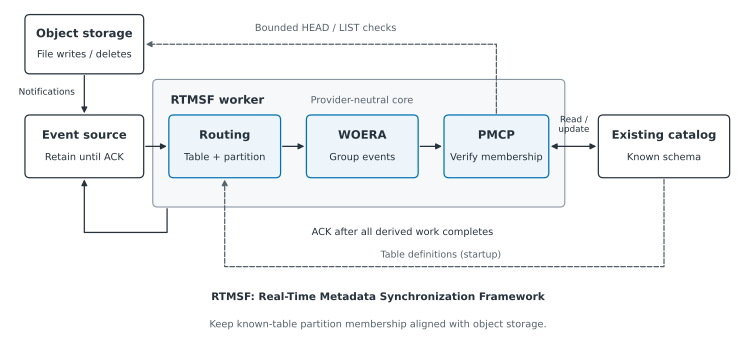

# RTMSF

[](pyproject.toml)
[](LICENSE)

**Real-Time Metadata Synchronization Framework**, by **Ankit Joshi**.

Independent ingestion and cleanup jobs can change data files directly in object storage without updating a shared catalog.
RTMSF centralizes partition-membership maintenance for these existing tables.
It processes notifications and checks affected partitions without rescanning the complete table.

The first eligible stored object triggers registration; intermediate changes preserve occupied entries; final deletion triggers removal after storage verification.
These updates follow the configured processing window. Membership does not establish batch readiness.
The [provider storage contracts](docs/system-behavior.md#routing-and-processing)
define eligible evidence: Azure excludes hidden/control files and directories;
AWS and GCP count markers.

WOERA groups events by partition. PMCP verifies storage and updates catalog membership.
Tables and their schemas already exist; RTMSF does not discover tables or infer schemas.
The supplied router requires ordered `column=value` paths and correct existing partition locations and storage descriptors.



The core uses provider-neutral interfaces. AWS supplies catalog adapters and the benchmark runner.
An OCI Compute worker passed lifecycle, burst-coalescing, and process-restart checks through OCI Object Storage, Events/Function, and Queue using the unchanged core and an in-memory catalog.
Real OCI catalog integration and multi-worker operation remain unvalidated.
The Azure VM worker passed a real ADLS/Event Grid/Service Bus/Databricks catalog lifecycle, a 12-file burst, and crash/replay before processing and after DROP. Four stale synthetic create hints were quarantined in the native DLQ. Azure performance remains unmeasured.
The GCP VM worker passed twelve native GCS/Pub/Sub/Hive Metastore gates and a fresh 24-hour serialized lifecycle run with 7,477 create/delete cycles. Independent final event, fixture, process-exit and Spark checks passed; the run completed with restarts and underlying retryable RPC causes remain unproven. [The GCP guide](docs/gcp.md) records its schema, architecture and limits.

## Choose your task

| Task | Guide |
|---|---|
| Understand the algorithm, guarantees, and limits | [System behavior](docs/system-behavior.md) |
| Inspect the OCI adapters, functional proof, and remaining catalog work | [OCI guide](docs/oci.md) |
| Inspect the Azure VM implementation, functional proof, and limits | [Azure guide](docs/azure.md) |
| Inspect the GCP architecture, schema, native gates and 24-hour results | [GCP guide](docs/gcp.md) |
| Run the AWS worker with existing tables | [AWS worker setup](docs/aws.md#run-the-normal-aws-worker) |
| Provision AWS resources and reproduce experiments | [AWS experiment setup](docs/aws.md#aws-experiment-setup) |
| Understand the five graphs, recovery table, and supporting checks | [Experiment specification](docs/experiments.md) |
| Inspect results or redraw saved graphs without cloud access | [Evidence guide](evidence/README.md) |

### Cloud entry points

All four paths use the shared synchronization core. Their launchers and validated
catalog boundaries differ; OCI and GCP supply finite proof runners.

| Provider | Code entry point | Deployment / validation path | Saved evidence |
|---|---|---|---|
| [AWS](docs/aws.md) | [Worker app](src/rtmsf/aws_app.py) | [ECS/Fargate experiment setup](docs/aws.md#aws-experiment-setup) and [benchmark runners](src/experiments/aws/) | [AWS measurements](evidence/SUMMARY.md) |
| [OCI](docs/oci.md) | [Function event bridge](src/rtmsf/oci_function.py) and [finite worker checks](src/experiments/oci/run.py) | [Manual Function packaging](docs/oci.md#live-resources-and-authentication); [burst/restart runners](src/experiments/oci/) use an in-memory catalog | [OCI proof](evidence/oci/README.md) |
| [Azure](docs/azure.md) | [Worker app](src/rtmsf/azure_app.py) | [VM systemd service](deploy/azure/rtmsf.service) and [crash harness](src/experiments/azure/crash_worker.py), with real Databricks integration | [Azure proof](evidence/azure/README.md) |
| [GCP](docs/gcp.md) | [Finite worker](src/experiments/gcp/run.py) and [soak supervisor](src/experiments/gcp/soak.py) | [Approved lab inputs](evidence/gcp/scripts/README.md#inputs-and-approval-prerequisites), with real Hive integration | [GCP proof](evidence/gcp/README.md) |

## Install and test locally

Requires Python 3.12+ and [uv](https://docs.astral.sh/uv/getting-started/installation/).

```bash
git clone https://github.com/ankitjoshi14/rtmsf-partition-sync.git
cd rtmsf-partition-sync
uv sync --frozen --extra dev --extra oci --extra azure --extra gcp
uv run --frozen --extra dev --extra oci --extra azure --extra gcp pytest -q
```

The full suite imports provider SDKs, so install all three provider extras as in CI.
Local tests use fakes and SDK stubs. They need no cloud account.

## Repository layout

```text
src/rtmsf/          Core algorithm, interfaces, and worker
  adapters/        AWS, OCI, Azure/Databricks, and GCP GCS/Pub/Sub/Hive
src/experiments/   Saved-result reporting and evidence export
  aws/             AWS provisioning, workloads, and measurement collection
  oci/             Finite OCI functional check with a test catalog
  azure/           Bounded fault harness for the real single-VM proof
  gcp/             Finite native worker, crash harness and serialized soak
tests/             Local verification
docs/              System behavior, experiment specification, and provider guides
  figures/         Shared architecture and AWS, OCI, Azure, GCP deployment SVGs
deploy/azure/      Supplied Azure VM systemd service
evidence/          AWS paper measurements and selected OCI/Azure/GCP functional evidence
  oci/             Selected reports, failures and deployed-source fingerprints
  azure/, gcp/     Provider results, observations, scripts, inputs and fingerprints
runs/              Original local execution records; generated and Git-ignored
```

Cloud-specific setup belongs in its provider guide and implementation folder.
AWS experiment runners share the benchmark report format. OCI functional checks write separate JSON records under Git-ignored `runs/`; selected outcomes and provenance are shared in [evidence/oci/](evidence/oci/README.md).
The [experiment specification](docs/experiments.md) defines that format and the measurements.

Experiment runners save measurements and generate reports under `runs/`.
The AWS offline exporter creates selected, verified measurement bundles for sharing in `evidence/`.
That folder belongs in Git; raw runs remain separate. Exporting does not rerun an experiment.
Current AWS measurements cover up to 10K starting partitions. Larger extensions remain unmeasured.

## Contributing and citation

Report bugs or propose focused changes through [GitHub issues](https://github.com/ankitjoshi14/rtmsf-partition-sync/issues).
Include a reproduction, expected behavior, and observed behavior. Run the local tests before submitting changes.
Use [CITATION.cff](CITATION.cff) to cite the software, released under the [MIT License](LICENSE).
