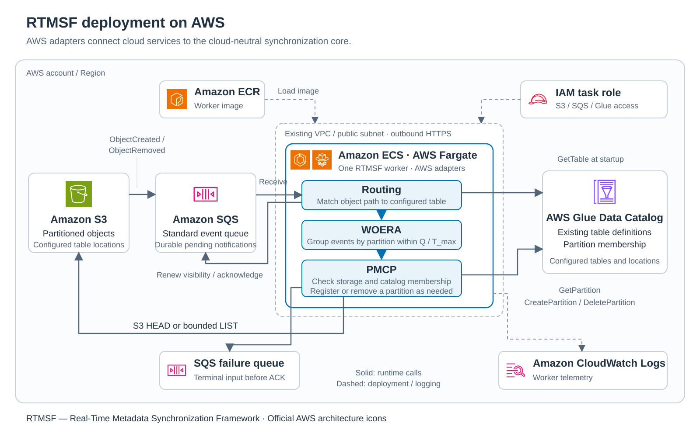

# AWS implementation and experiments

The AWS implementation uses S3 storage, SQS notifications, Glue catalog entries, and an ECS/Fargate worker.
The core algorithm and report format stay separate from this provider's deployment.

- [Run the normal AWS worker](#run-the-normal-aws-worker) with your existing tables and queues.
- [Provision experiment resources](#aws-experiment-setup), build the image, and run a small validation.
- [Repeat the complete 10K matrix](#complete-10k-execution) after setup passes.
- [Export saved evidence](#export-saved-evidence) without AWS access.
- [Stop and clean up](#shutdown-and-retained-resources) after execution.

## AWS deployment



The diagram uses official AWS architecture service and resource icons.
[Icon sources and fingerprints](figures/aws-icons.md) record the July 31, 2026
package and exact mappings, including separate ECS and Fargate symbols.

S3 notifications enter SQS. One Fargate task runs routing, WOERA, and PMCP through AWS adapters.
Routing loads Glue table definitions. PMCP checks S3 and reads, creates, or deletes Glue partitions.
The worker renews queue visibility, acknowledges completed input, and sends terminal failures to a separate queue.
ECR supplies the image; the task role grants access; CloudWatch Logs records telemetry.

The supplied experiment stack uses existing public subnets and starts with zero worker tasks.
The runner starts the worker for trials. Athena MSCK and the Glue crawler remain separate comparison systems.

## Run the normal AWS worker

This path maintains your existing tables. It does not create experiment resources.
Supply existing Glue tables, S3 buckets, an SQS event queue, and a separate failure queue.
Configure S3 `ObjectCreated:*` and `ObjectRemoved:*` notifications to reach the event queue.
The queue policy must permit those bucket notifications.
The worker identity needs S3 read/list, Glue partition read/create/delete, SQS receive/delete/visibility, and failure-queue send permissions.
Restrict these permissions to your configured resources; experiment IAM roles cover test fixtures only.
Align initial catalog membership before starting. Events do not repair partitions that receive no eligible notification.
Use consecutive `column=value` folders below the table root, in Glue partition-column order.
Existing partition locations and storage descriptors must already match that layout and the table definition.
RTMSF copies the table descriptor for new entries; it does not validate or repair existing partition metadata.
Keep one active worker for this supplied SQS setup.
Keep table/schema administration, batch readiness, initial alignment, and exceptional repair under your lake operator's control.

Run from the repository root. Replace the example login, queues, bucket, and table:

```bash
uv sync --frozen --extra aws
export AWS_PROFILE=your-profile
export AWS_DEFAULT_REGION=us-west-2
export EVENT_QUEUE_URL=https://sqs.us-west-2.amazonaws.com/123456789012/your-event-queue
export DEAD_LETTER_QUEUE_URL=https://sqs.us-west-2.amazonaws.com/123456789012/your-failure-queue
export RTMSF_SOURCES='{"orders":"your-orders-bucket"}'
export RTMSF_TABLE_IDS='["your_database.orders"]'
uv run --frozen --extra aws python -m rtmsf.aws_app
```

`RTMSF_SOURCES` maps logical source names to buckets.
`RTMSF_TABLE_IDS` selects existing `database.table` identifiers; the worker reads their locations and partition columns at startup.
Use Ctrl+C for a local stop. Unacknowledged input remains in SQS for replay.
See [worker settings and bounds](#aws-worker-settings-and-bounds) before changing defaults.
The Docker `production` target runs this same worker; the experiment target adds fault and comparison launchers.

### Restart and exceptional repair

Your operator or supervisor manages replacement; the normal launcher supplies no deployment fencing.

1. Stop the worker or confirm process exit after a failure. Disable automatic replacement during maintenance.
2. Verify the old process exits. For ECS, wait for the previous task's `lastStatus=STOPPED`.
3. Preserve both queues. Coordinate writers before repairing catalog metadata or changing table definitions.
4. Restore compatible definitions and membership, then start exactly one worker.
5. Allow unacknowledged input to return after its visibility lease. Monitor queue age, outcomes, and terminal input.

A restart reloads table definitions; it does not repair existing partition metadata.
Diagnose terminal input using the [terminal-input guidance](system-behavior.md#terminal-input); completed short-lived activity does not always require replay.
Use representative traffic and message sizes to check acceptable delay, buffer limits, and queue retention before adoption.

## AWS experiment setup

This path provisions disposable test resources and runs the workloads in [the experiment specification](experiments.md).
An account number alone does not grant access or configure a network.

Supply these prerequisites:

- Python 3.12+, uv, AWS CLI, and a running Docker engine with ARM64 build support.
- A configured AWS profile with access to the target account.
- Permission to create the template resources and operate S3, SQS, Glue, Athena, ECS, ECR, CloudFormation, CloudWatch, and CloudTrail.
- IAM role creation/policy permissions and `iam:PassRole` for worker and crawler roles.
- An existing VPC and public subnets in `us-west-2`, with internet-gateway routing and outbound HTTPS access.

The template creates buckets, queues, catalog resources, worker infrastructure, logging, and roles.
It does not create your AWS login, VPC, or subnets. Experiment execution incurs AWS charges.

Run these commands from the repository root. Current fixture tools require `us-west-2` and `rtmsf-` stack names.
The stack starts with zero workers. Public-subnet HTTPS access avoids creating a NAT gateway.

## 1. Install and provision

Replace the example account/network values before running:

```bash
uv sync --frozen --extra dev
export RTMSF_PROFILE=your-profile
export RTMSF_ACCOUNT=123456789012
export RTMSF_REGION=us-west-2
export RTMSF_STACK=rtmsf-paper-v1
export RTMSF_VPC=vpc-REPLACE
export RTMSF_SUBNET_1=subnet-REPLACE
export RTMSF_SUBNET_2=subnet-REPLACE
```

These terminal variables supply deployment and experiment arguments; they do not configure the normal worker directly.

| Setting | Meaning |
|---|---|
| `RTMSF_PROFILE` | Configured AWS login used by the host runner. |
| `RTMSF_ACCOUNT` | Expected account number; deployment and runner reject a mismatch. |
| `RTMSF_REGION` | Experiment region; current tools require `us-west-2`. |
| `RTMSF_STACK` | CloudFormation deployment name; it starts with `rtmsf-`. |
| `RTMSF_VPC`, `RTMSF_SUBNET_1`, `RTMSF_SUBNET_2` | Existing worker network and public subnet IDs. |
| `--experiment-id` | Name component for the base data and crawler buckets. |
| `--database` | Glue database created for disposable test tables. |

Check access before provisioning:

```bash
aws sts get-caller-identity --profile "$RTMSF_PROFILE" --region "$RTMSF_REGION" \
  --query Account --output text
uv run --frozen --extra dev python -c \
  'import boto3, os; print(boto3.Session(profile_name=os.environ["RTMSF_PROFILE"], region_name=os.environ["RTMSF_REGION"]).client("sts").get_caller_identity()["Account"])'
docker info --format '{{.ServerVersion}}'
```

Both identity commands must print `RTMSF_ACCOUNT`. Docker must report its server version.
These checks establish access, not permission for every later AWS operation.
Stop at a failed command and resolve its error before proceeding.
Run commands sequentially; these examples do not provide a single automatic setup script.

```bash
uv run --frozen --extra dev python -m experiments.aws.deploy \
  --stack "$RTMSF_STACK" --expected-account "$RTMSF_ACCOUNT" \
  --profile "$RTMSF_PROFILE" --region "$RTMSF_REGION" \
  --experiment-id paper-v1 --database rtmsf_experiments \
  --vpc "$RTMSF_VPC" --subnets "$RTMSF_SUBNET_1" "$RTMSF_SUBNET_2"
```

Deploy the stack once, then reuse it for sequential experiment executions.
Choose new stack, experiment and database names if creating a separate deployment.
`--experiment-id` is 3–20 lowercase letters/digits/hyphens, starting with a letter.
The named base buckets become `rtmsf-<experiment-id>-data-<account>-<region>` and
`rtmsf-<experiment-id>-crawler-<account>-<region>`; other stack resources inherit the
chosen stack prefix. These names apply to new deployments; existing AWS
resources retain their original names.
The command prints the stack outputs. Store its `EcrRepositoryUri` in
`RTMSF_ECR`; it is a registry/repository address, not a credential.

Deployment checks the account, region, stack name, and CloudFormation completion.
The experiment runner checks input bounds, stack readiness, old worker shutdown, image identity, and recorded outcomes.
These checks do not pre-authorize every service call; missing permissions fail the corresponding AWS operation.

## 2. Build this source and record its identity

Use Docker with ARM64 build support. Rebuild the worker image when its runtime
code or dependency configuration changes. Host-only runner, report, test, or
documentation changes may reuse an image whose runtime and build-input hashes still match;
each execution separately archives and identifies its current host source.
The default Docker target is `production`, whose entry point is `rtmsf.aws_app`.
Build `--target experiment` for this pilot so the same image also contains
`experiments.aws.crash_worker`. The runner selects normal startup for measurement
trials and the experiment launcher only for deliberate fault trials.

The runner selects the fault launcher only for [the four crash cases](experiments.md#table-1--crash-recovery).
Normal worker startup does not inject faults.
The next block records source and image identities so the runner can reject a mismatched Docker image.
It runs local image inspection and saves `image-build.json`; it does not collect experiment measurements.

```bash
export RTMSF_ECR=REPLACE_WITH_EcrRepositoryUri
export RTMSF_SOURCE_HASH=$(uv run --frozen --extra dev python -c \
  'from pathlib import Path; from experiments.evidence import source_snapshot; print(source_snapshot(Path("."))["sha256"])')
export RTMSF_TAG=pilot-source-$RTMSF_SOURCE_HASH
export RTMSF_BUILD_MANIFEST="${RTMSF_BUILD_MANIFEST:-runs/build-$RTMSF_SOURCE_HASH/image-build.json}"

docker buildx build --platform linux/arm64 --provenance=false --load \
  --target experiment -t rtmsf:pilot .
aws ecr get-login-password --profile "$RTMSF_PROFILE" --region "$RTMSF_REGION" \
  | docker login --username AWS --password-stdin "${RTMSF_ECR%%/*}"
docker tag rtmsf:pilot "$RTMSF_ECR:$RTMSF_TAG"
docker push "$RTMSF_ECR:$RTMSF_TAG"

export RTMSF_DIGEST=$(aws ecr describe-images \
  --profile "$RTMSF_PROFILE" --region "$RTMSF_REGION" \
  --repository-name "${RTMSF_ECR#*/}" --image-ids imageTag="$RTMSF_TAG" \
  --query 'imageDetails[0].imageDigest' --output text)
export RTMSF_IMAGE="$RTMSF_ECR@$RTMSF_DIGEST"

uv run --frozen --extra dev python - <<'PY'
import hashlib, json, os, subprocess
from pathlib import Path
inspect_image = '''
import hashlib, importlib.metadata, json
from pathlib import Path
root = Path('/app')
files = sorted((root / 'src/rtmsf').rglob('*.py')) + [
    root / name for name in ('src/experiments/__init__.py',
                            'src/experiments/aws/__init__.py',
                            'src/experiments/aws/crash_worker.py',
                            'src/experiments/aws/activity_worker.py')]
print(json.dumps({
    'files': {str(p.relative_to(root)): hashlib.sha256(p.read_bytes()).hexdigest() for p in files},
    'runtime_dependencies': {n: importlib.metadata.version(n) for n in ('boto3', 'botocore')},
}))
'''
runtime = subprocess.check_output([
    'docker', 'run', '--rm', '--entrypoint', 'python', 'rtmsf:pilot', '-c',
    inspect_image,
], text=True)
manifest = Path(os.environ['RTMSF_BUILD_MANIFEST'])
manifest.parent.mkdir(parents=True, exist_ok=True)
manifest.write_text(json.dumps({
    'source_hash': os.environ['RTMSF_SOURCE_HASH'],
    'image': os.environ['RTMSF_IMAGE'],
    'target': 'experiment',
    'build_files': {name: hashlib.sha256(Path(name).read_bytes()).hexdigest()
                    for name in ('Dockerfile', 'pyproject.toml', '.dockerignore')},
    **json.loads(runtime),
}, indent=2) + '\n')
PY
```

The image digest identifies the runtime; `uv.lock` pins the local runner environment.
The build manifest contains no AWS credentials.
`--update-image` changes only the deployed image parameter. Template changes require a fresh deployment.
Runtime/build-input hashes must match; retain each verified manifest with its run.

## 3. Deploy and run a small validation

```bash
uv run --frozen --extra dev python -m experiments.aws.deploy \
  --stack "$RTMSF_STACK" --expected-account "$RTMSF_ACCOUNT" \
  --profile "$RTMSF_PROFILE" --region "$RTMSF_REGION" \
  --update-image --image "$RTMSF_IMAGE"

uv run --frozen --extra experiment python -m experiments.aws.run \
  --stack "$RTMSF_STACK" --expected-account "$RTMSF_ACCOUNT" \
  --profile "$RTMSF_PROFILE" --region "$RTMSF_REGION" \
  --sizes 100 1000 --files 1 100 1000 --graph4-partitions 1000 \
  --layout-sizes 100 1000 --repetitions 1 --timeout-seconds 600 --max-minutes 240 --activity quick \
  --request-source cloudwatch --audit-wait-seconds 600 \
  --build-manifest "$RTMSF_BUILD_MANIFEST" --output-dir runs
```

This command selects all five graphs, recovery, supporting checks, and activity.
It uses one repetition per condition and fresh fixtures.
The [experiment specification](experiments.md) defines layouts, triggers, collection windows, and plotting rules.
Use [Complete 10K execution](#complete-10k-execution) for the measured matrix.

Each measurement trial uses an isolated bucket and crawler queue where applicable.
For example: `rtmsf-g2-glue-p1000-r1-<run>` or `rtmsf-g4-rtmsf-p1000-f100-r1-<run>`.
`trial-buckets.json` records ownership and cleanup.
Graph 5 requires CloudWatch; selective Graph 2/3/4 modes also accept CloudTrail for diagnostics.

Read `SUMMARY.md` first in the printed execution directory:

```text
runs/<execution>/
├── SUMMARY.md             # Outcomes and missing measurements
├── graph_data.csv         # Points for the five graphs
├── graph_1.png / .pdf      # Likewise graph_2 through graph_5
├── recovery_table.md      # Four crash cases
├── checks_table.md        # Supporting workloads
├── report_inputs.json     # Offline report inputs
└── ...                    # Configuration, raw records, source and hashes
```

Exit code 0 requires all selected work and required collection to succeed.
Failed, incomplete, or unattempted work returns 1 after saving the bundle.
The runner retains `source.tar.gz`, image identity, raw observations, and artifact hashes.
It does not replace `evidence/`; use [the offline exporter](#export-saved-evidence).
After interruption, follow [shutdown and cleanup](#shutdown-and-retained-resources).

### What a run and a rerun create

Every execution gets an ID such as `run_20260929_090000_a1b2`: UTC date/time plus
a random suffix. All its repetitions and graphs go into **one local folder**,
`runs/run_20260929_090000_a1b2/`. The folder is created automatically and contains
the files shown above. The runner records actual resource names in
`experiment.jsonl`; `trial-buckets.json` also maps measurement tables/buckets
and records their cleanup.
`runtime-api-counts.json` contains run-wide adapter totals for diagnostics;
graph request counts come from the separate per-trial measurement windows.

The complete-matrix commands create separate `graphs/`, `activity/`, and `buffer/` phase folders under the chosen parent.
Each phase contains its own timestamped execution bundle.
`build/` contains the separately generated image manifest.
The runners do not create top-level `preflight.json`, `execution-status.json`, or console `.log` files.
Those are optional execution records; they are not required report inputs.
Offline regeneration creates the chosen output folder without collecting new measurements.

The stack and Glue database (`rtmsf_experiments` by default) are reused.
**Tables are fresh for every condition,
method and repetition.** For Graphs 2/3 at 100 partitions, repetition 1:

| Method | Example table in `rtmsf_experiments` |
|---|---|
| RTMSF | `rtmsf_scale_p100_r1_20260929_090000_a1b2` |
| Glue event crawler | `crawler_scale_p100_r1_20260929_090000_a1b2` |
| Athena MSCK | `msck_scale_p100_r1_20260929_090000_a1b2` |

Names follow **method → experiment → condition → repetition → run**.
`p100` means 100 starting partitions, `f100` means 100 existing files in the
changed partition, and `r1` means repetition 1. Graphs 2 and 3 share the `scale`
tables and trials. Other RTMSF table examples use the same run suffix:

| Purpose | Table name (`<run>` = `20260929_090000_a1b2`) |
|---|---|
| Graph 1 | `rtmsf_lifecycle_r1_<run>` |
| Graph 4 | `rtmsf_files_p100_f100_r1_<run>` |
| Graph 5 | `rtmsf_layout_day_first_p100_r1_<run>` (or `tenant_first`) |
| Recovery | `rtmsf_recovery_add_before_processing_r1_<run>` (one per crash case) |
| Supporting check | `rtmsf_check_short_burst_r1_<run>` (one per named check/fixture) |

Baseline tables use `crawler_` or `msck_` where applicable. The run suffix separates reruns.
Each evidence record includes the trial ID and actual AWS table name.

For a small all-output run with `--sizes 100 --files 1 100
--graph4-partitions 100 --layout-sizes 100 --repetitions 1`, the runner creates
**24 new tables**: 11 comparison tables, 1 lifecycle table, 4 recovery tables,
and 8 supporting-check tables (the routing check needs two). The shared stack
also has one prototype table, created at deployment and copied for every method.
Other settings change the number of fresh tables; the main validation command
above creates 31.

Rerunning the same command creates a new execution ID, folder, table names,
measurement buckets and object prefixes. It runs fresh work; it does not append
to the previous CSV or resume an old run. Keep failed/incomplete bundles too.

At completion, the runner attempts to stop the worker and logging and remove
comparison tables/buckets and temporary crawler queues. Lifecycle, recovery and
supporting-check tables/data remain, along with shared stack resources and local
results. Inspect the recorded cleanup outcome; `--cleanup-run` retries measurement
resource cleanup without rerunning the experiment. Offline graph regeneration
uses existing CSV/outcomes and creates no AWS resources.

### Choose sizes and repetitions

Keep the common profile/account/stack/region, `--request-source cloudwatch`,
`--audit-wait-seconds 600`, `--build-manifest` and `--output-dir` arguments above.
Select all desired sizes in one command. For example, these options run Graphs
2/3 at four sizes, once per method:

```text
--comparisons-only --sizes 10 100 500 1000 --repetitions 1
```

That execution produces one CSV and its graphs in one result folder. The
plotting utility can redraw those reports offline from the saved records.

| Setting | Meaning |
|---|---|
| `--sizes` | Starting partition counts for Graphs 2/3; each trial adds one new partition. |
| `--files` | Existing files in the changed partition for Graph 4; each trial appends one file. |
| `--graph4-partitions` | Fixed table partition count for Graph 4. |
| `--layout-sizes` | Starting partition counts in each Graph 5 layout. |
| `--repetitions` | Fresh repetitions per comparison condition and method. |
| `--correctness-repetitions` | Fresh lifecycle, recovery, and supporting-check repetitions. |
| `--timeout-seconds` | Waiting limit for an individual operation or observation. |
| `--max-minutes` | Budget for starting new work; setup and final collection can extend total elapsed time. |
| `--audit-wait-seconds` | Final quiet measurement-delivery wait; CloudWatch requires at least 600 seconds. |
| `--build-manifest` | Saved image/source identity used to reject stale worker images. |
| `--output-dir` | Parent directory for a new execution folder. |

`Q=10 seconds` and `T_max=31 seconds` stay fixed in the experiment runner.
Use the normal worker's environment variables to configure your own deployment.

| Outputs | Size controls |
|---|---|
| Graphs 2/3 | `--comparisons-only --sizes N1 N2 ...` |
| Graph 4 | `--graph4-only --files F1 F2 ... --graph4-partitions N` |
| Graph 5 | `--graph5-only --layout-sizes N1 N2 ...` |

Omit the selective mode flag for all five graphs, recovery, and supporting checks.
The runner accepts up to 100K main-layout/Graph 5 partitions and 10K existing files.
These input limits do not establish measured scale.
At 100K, three methods with five repetitions prepare 1.5 million baseline files.
Choose a time budget that covers independent fixture preparation.

### Check CloudWatch request counters

To validate request instrumentation independently of the graph workloads:

```bash
uv run --frozen --extra experiment python -m experiments.aws.check_request_metrics \
  --profile "$RTMSF_PROFILE" --expected-account "$RTMSF_ACCOUNT" \
  --region "$RTMSF_REGION"
```

It creates six buckets named `rtmsf-cw-check-n<count>-r<repetition>-<run>`:
1, 10 and 100 requests per family, twice. Odd repetitions use HEAD object and
LIST V2; even repetitions use HEAD bucket and LIST V1. Multi-page cases exercise
pagination. Allow about 30 minutes for activation, requests and metric delivery.
Read `calibration.csv` in the printed evidence directory. It records expected
and observed counts, with blanks for missing data; raw request IDs, metric
snapshots, source and hashes accompany it. The command removes its temporary
buckets and metric configurations after collection. A pass verifies these
known batches, not guaranteed completeness of future CloudWatch measurements.
CloudWatch can label requests with a later minute. The bucket stays idle while
the collector includes complete minutes through `quiet_until`; the original
workload start/end remain recorded separately. Do not browse the trial bucket
or run verification reads during this interval.
Add `--list-only` to test zero HEAD/GET activity in fresh buckets. The live
control returned LIST=1 and AllRequests=1, with no HEAD/GET datapoints. Those
absent counters are inferred as observed zeros only when recorded operation
counts fully account for AllRequests, method activity exists, and no metric
read failed. Otherwise they remain unknown. Raw evidence distinguishes this
inference from an explicit zero datapoint.

After interruption, `--resume <check-directory> --cleanup-only` removes only
that check's remaining buckets without sending more test requests. Include the
same profile, account and region arguments. A cleanup receipt preserves the
original run record. The graph runner uses CloudWatch by default and retains
CloudTrail as supporting evidence.

Use these selective options to repeat particular checks on fresh fixtures:

```text
--checks-only duplicate_old_events rapid_changes
--recovery-only add_after_catalog_change
--graph5-only --layout-sizes 100 --repetitions 1 --max-minutes 60
```

Keep failed original runs and follow-up runs separately.

Regenerate all figures and tables without AWS calls, using the printed pilot
directory; the output below is a separate directory:

```bash
export RTMSF_RUN=runs/REPLACE_WITH_PRINTED_PILOT_ID
uv run --frozen --extra experiment python -m experiments.figures \
  --csv "$RTMSF_RUN/graph_data.csv" --results "$RTMSF_RUN/report_inputs.json" \
  --output-dir "${RTMSF_RUN}-regenerated"
```

## Bounded activity validation

The [activity protocol](experiments.md#bounded-activity-validation) compares the
complete worker with an experiment-only immediate handler and exercises ongoing
mixed traffic. It uses the same stack and experiment image. Build and deploy that
image above, then run:

```bash
uv run --frozen --extra experiment python -m experiments.aws.activity \
  --stack "$RTMSF_STACK" --expected-account "$RTMSF_ACCOUNT" \
  --profile "$RTMSF_PROFILE" --region "$RTMSF_REGION" \
  --build-manifest "$RTMSF_BUILD_MANIFEST" --repetitions 1 --max-minutes 65
```

Use `--conditions quick spaced distributed mixed` for just the comparison, or
select continuous conditions listed by `--help`. The measured subset uses:

```text
--conditions quick spaced distributed mixed
continuous_1ps_10p continuous_1ps_20p continuous_3ps_10p continuous_3ps_20p
load_1ps_1000p load_5ps_1000p load_20ps_10p load_20ps_1000p
--repetitions 3 --burst-repetitions 3 --max-minutes 360
```

The printed activity bundle contains both activity CSVs, summary, and supporting records.
It keeps the five-graph results separate. Regenerate its tables offline:

```bash
export RTMSF_ACTIVITY_RUN=runs/REPLACE_WITH_PRINTED_ACTIVITY_ID
uv run --frozen --extra experiment python -m experiments.activity_reports \
  --results "$RTMSF_ACTIVITY_RUN/report_inputs.json" --output-dir "${RTMSF_ACTIVITY_RUN}-regenerated"
```

For the focused single-worker buffer comparison, use the same activity command
above with these additional options (allow up to 240 minutes for setup, eight
conditions, measurement delivery and cleanup):

```text
--conditions load_20ps_10p load_20ps_1000p --buffer-sizes 100 1000
--buffer-bytes 16777216 --queue-visibility-seconds 1000
--repetitions 2 --max-minutes 240
```

Each condition has a fresh worker process. Buffer settings and sampled memory
are included in the activity CSV/report; the five graph outputs do not change.

## Complete 10K execution

This path repeats all five graphs, recovery, supporting checks, activity, and buffer validation.
It measures catalog maintenance on AWS; it does not measure downstream consumer performance.
The completed matrix is in [the specification](experiments.md#outputs-at-a-glance).
It uses 170 comparison trials, 48 activity conditions and eight buffer conditions.
The comparison fixtures alone seed 604,480 files. The 170 required two-minute
quiet periods take at least 5 hours 40 minutes; fixture setup, crawler runs,
recovery and collection add time. Allow an overnight run and possible daytime
completion. Time budgets below stop new trials, not all ongoing collection.

Use a clean checkout and frozen dependencies. Repeat the [access checks](#1-install-and-provision) before provisioning trial resources.
Confirm a ready stack, stopped worker, and empty failure queue.
Create the execution directory below before section 2 if its image manifest belongs inside this run.
The build block preserves an explicitly selected `RTMSF_BUILD_MANIFEST` path.
Then build the image and update the idle stack using sections 2 and 3's image-update command.

Each phase uses its existing runner, fresh fixtures and independent outcome/hash
records. Keep all three under one top-level execution directory. The activity
repetition count is three, independently of the five graph-comparison repeats:

```bash
export RTMSF_EXECUTION="runs/10k_$(date -u +%Y%m%d_%H%M%S)"
mkdir -p runs
mkdir "$RTMSF_EXECUTION"
export RTMSF_BUILD_MANIFEST="$RTMSF_EXECUTION/build/image-build.json"
```

After building/validating the image and updating the idle stack, run these commands
sequentially from the same checkout. No phase reads results from another phase:

```bash
uv run --frozen --extra experiment python -m experiments.aws.run \
  --stack "$RTMSF_STACK" --expected-account "$RTMSF_ACCOUNT" \
  --profile "$RTMSF_PROFILE" --region "$RTMSF_REGION" \
  --sizes 100 1000 5000 10000 --layout-sizes 100 1000 5000 10000 \
  --files 1 100 1000 --graph4-partitions 1000 \
  --repetitions 5 --correctness-repetitions 3 \
  --timeout-seconds 900 --max-minutes 1800 \
  --request-source cloudwatch --audit-wait-seconds 600 \
  --build-manifest "$RTMSF_BUILD_MANIFEST" \
  --output-dir "$RTMSF_EXECUTION/graphs"

uv run --frozen --extra experiment python -m experiments.aws.activity \
  --stack "$RTMSF_STACK" --expected-account "$RTMSF_ACCOUNT" \
  --profile "$RTMSF_PROFILE" --region "$RTMSF_REGION" \
  --build-manifest "$RTMSF_BUILD_MANIFEST" \
  --quick --repetitions 3 --burst-repetitions 3 --max-minutes 360 \
  --output-dir "$RTMSF_EXECUTION/activity"

uv run --frozen --extra experiment python -m experiments.aws.activity \
  --stack "$RTMSF_STACK" --expected-account "$RTMSF_ACCOUNT" \
  --profile "$RTMSF_PROFILE" --region "$RTMSF_REGION" \
  --build-manifest "$RTMSF_BUILD_MANIFEST" \
  --conditions load_20ps_10p load_20ps_1000p \
  --buffer-sizes 100 1000 --buffer-bytes 16777216 \
  --queue-visibility-seconds 1000 --repetitions 2 --max-minutes 240 \
  --output-dir "$RTMSF_EXECUTION/buffer"
```

Before starting the next phase, check that the previous command exited zero and
its worker/crawler shutdown and resource cleanup completed. If it failed, preserve
the bundle, resolve the recorded failure and stop before touching shared resources
again. The `--quick` activity flag selects the four representative load points;
it does not shorten their 120-second schedules or omit the four burst and four
continuous schedules. Buffer timing and memory settings stay distinct from the
normal-worker defaults.

## Export saved evidence

The offline exporter verifies saved artifact hashes and generates [the evidence bundle](../evidence/README.md).
It preserves CSV bytes, unknown values, failures, and raw bundles.

Pass the printed raw phase directories. For the completed 10K execution:

```bash
uv run --frozen --extra experiment python -m experiments.export \
  --figures runs/10k_20261003/graphs/run_20261003_080700_dfd9 \
  --activity runs/10k_20261003/activity/run_20261004_020915_8da9 \
  --buffer runs/10k_20261003/buffer/run_20261004_045939_c0fa \
  --output-dir runs/exported-10k
```

Use your own printed phase directories for another execution.
Omit an unselected phase option. The exporter keeps each phase separate.
An existing destination causes an error; choose a fresh path for another export.
The export omits raw CloudTrail downloads and private configuration fields.
It replaces account numbers with a consistent placeholder and retains source/image identity.
Use the verified export as the repository's `evidence/` content after preserving the previous export.

Verify the exported files from inside its directory:

```bash
shasum -a 256 -c SHA256SUMS
```

Matching saved inputs and report-generator versions produce the same export bytes.
New AWS executions can produce different timings and counts.

## Shutdown and retained resources

The pilot attempts worker, crawler, and CloudTrail shutdown in `finally` and
records shutdown failures. Check those results and the actual task ARNs reaching
`STOPPED`. If the runner is forcibly interrupted, set the service desired
count to zero and wait for its tasks to stop before another run. Resolve its
`ClusterName`, `ServiceName`, and `TrailName` from the stack outputs; stop any
remaining trial crawler and trail logging too.

For an interrupted run, retrieve the experiment stack's worker and trail names:

```bash
export RTMSF_CLUSTER=$(aws cloudformation describe-stacks \
  --stack-name "$RTMSF_STACK" --profile "$RTMSF_PROFILE" --region "$RTMSF_REGION" \
  --query 'Stacks[0].Outputs[?OutputKey==`ClusterName`].OutputValue | [0]' --output text)
export RTMSF_SERVICE=$(aws cloudformation describe-stacks \
  --stack-name "$RTMSF_STACK" --profile "$RTMSF_PROFILE" --region "$RTMSF_REGION" \
  --query 'Stacks[0].Outputs[?OutputKey==`ServiceName`].OutputValue | [0]' --output text)
export RTMSF_TRAIL=$(aws cloudformation describe-stacks \
  --stack-name "$RTMSF_STACK" --profile "$RTMSF_PROFILE" --region "$RTMSF_REGION" \
  --query 'Stacks[0].Outputs[?OutputKey==`TrailName`].OutputValue | [0]' --output text)
aws ecs update-service --cluster "$RTMSF_CLUSTER" --service "$RTMSF_SERVICE" --desired-count 0 \
  --profile "$RTMSF_PROFILE" --region "$RTMSF_REGION"
aws cloudtrail stop-logging --name "$RTMSF_TRAIL" \
  --profile "$RTMSF_PROFILE" --region "$RTMSF_REGION"
```

Stop remaining trial crawlers named in that run's `crawler/` records with `aws glue stop-crawler --name <crawler-name>`.
Include the same profile and region arguments. Wait for worker tasks to reach `STOPPED` and crawlers to reach `READY`.
The cleanup command rejects a worker that still runs or stops.
Then retry cleanup of only that run's measurement resources:

```bash
export RTMSF_RUN=runs/REPLACE_WITH_PRINTED_RUN_ID
uv run --frozen --extra experiment python -m experiments.aws.run \
  --stack "$RTMSF_STACK" --expected-account "$RTMSF_ACCOUNT" \
  --profile "$RTMSF_PROFILE" --region "$RTMSF_REGION" \
  --cleanup-run "$RTMSF_RUN"
```

The cleanup command saves a separate receipt. It preserves the original measurements.
For an activity/buffer bundle, pass its printed phase directory as `RTMSF_RUN`.

The runner removes its temporary measurement buckets, tables, and crawler queues.
The base stack, shared buckets/queues, supporting-check fixtures, ECR images, and
logs remain. Deleting the stack alone does not delete resources marked `Retain`
in the template. Remove those explicitly when you no longer need the data. The
worker has no idle compute cost after stopping; retained storage and logging can
still incur charges.

## AWS worker settings and bounds

These settings configure `rtmsf.aws_app` through environment variables.
Experiment runners set their worker values automatically; host `RTMSF_PROFILE` variables are separate.

| Variable | Meaning |
|---|---|
| `EVENT_QUEUE_URL`, `DEAD_LETTER_QUEUE_URL` | Durable input and terminal failure queues |
| `RTMSF_SOURCES` | JSON map of logical source IDs to S3 bucket names |
| `RTMSF_TABLE_IDS` | JSON list of configured `database.table` identifiers |
| `SETTLING_MS` | Q; current pilot uses 10000 (10 seconds) |
| `MAXIMUM_MS` | Maximum buffering residence; experiment uses 31000 |
| `QUEUE_VISIBILITY_SECONDS` | Initial/renewed delivery lease; default 180 |
| `MAX_PENDING_DELIVERIES` | Shared unfinished-message cap across all configured tables; default 100 |
| `MAX_BUFFER_BYTES` | Retained raw SQS body budget; default 16777216 (16 MiB), minimum 1 MiB |

The AWS adapter reserves room for maximum-size messages before each receive.
When byte capacity is unavailable it waits; input remains in SQS. This budget
excludes parsed events, table definitions, temporary response/decoding memory
and SDK state, so reserve additional process memory. Existing limits also bound
active partitions (1,000) and decoded events (10,000). Increasing the message
cap changes worst-case queue renewal time; startup rejects an insufficient
visibility timeout. The focused 100/1,000 comparison uses 1,000 seconds for both
settings, leaving Q=10 and T_max=31 unchanged. This longer lease can delay crash
replay; it is not a universal deployment recommendation or a freshness bound.

Every received batch must fit the remaining decoded-event and active-partition
budgets. Exceeding either fails the worker without acknowledging the batch.
Replay alone cannot fix an intrinsically oversized delivery; adapter envelope
bounds and deployment budgets must be compatible. The AWS adapter does not
split oversized multi-event envelopes.

S3/Glue and queue mutation calls use explicit SDK timeout/retry settings.
Startup checks the queue visibility budget before polling.
[System behavior](system-behavior.md#provider-integrations) describes the core interfaces implemented by the AWS adapters.

Crash tests use the separate `experiments.aws.crash_worker` launcher and its
`RTMSF_EXPERIMENT_FAULT` configuration. It records one durable marker outside
table data, then exits at the selected boundary: before PMCP processing or after
a successful catalog change, before acknowledgement. The marker prevents an
endless crash loop. Normal `rtmsf.aws_app` startup does not read these fault settings.
