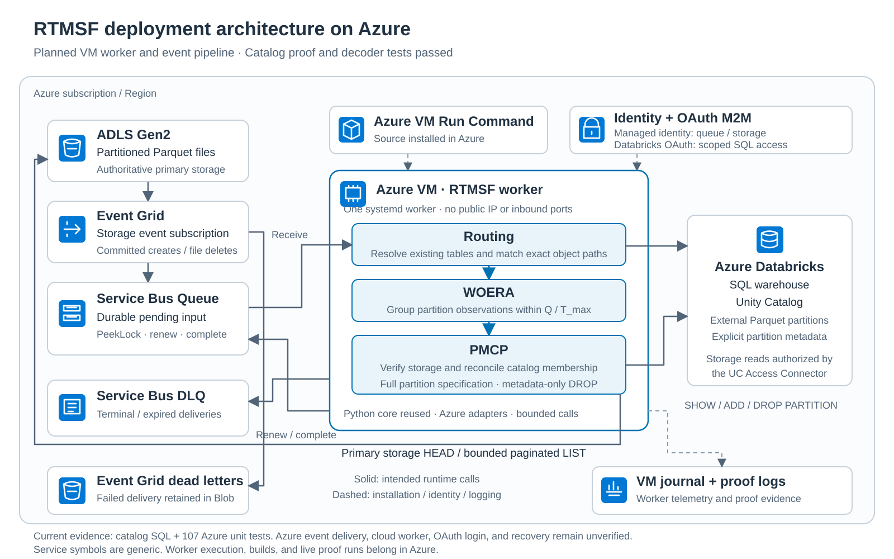

# Azure deployment architecture

The first Azure target is **ADLS Gen2 → Event Grid → Service Bus → one Azure VM worker → Databricks Unity Catalog**. It reuses the existing Python routing, WOERA, and PMCP core. The figure uses the same visual style as the [AWS](figures/aws-deployment.svg) and [OCI](figures/oci-deployment.svg) deployment diagrams, with [official Microsoft Azure service icons](figures/azure-icons.md).

## Observed functional proof

The real Azure pipeline processed committed Blob REST events for the disposable external Parquet table `rtmsf_azure_proof_20261014.rtmsf_proof.worker_probe` on October 16, 2026. The table has explicit `dt` partition metadata enabled. One private Azure VM runs the same routing, WOERA, and PMCP core used by AWS; managed identity authorizes storage, queue, and Key Vault access, and SQL-scoped Databricks OAuth authorizes the catalog adapter. No local worker, SDK calls, tests, builds, or fixtures were executed.

Each completed stage used an independent catalog query, authoritative storage listing, worker telemetry, and an empty source-queue check. [Saved Azure evidence](../evidence/azure/README.md) records the actual observations and source hashes.

| Scenario | Observed result |
|---|---|
| First file | `dt=life` registered; row `id=1` became queryable. |
| Additional file | Rows `1,2`; ADD was a no-op for the occupied partition. |
| Overwrite | Rows `2,11`; partition membership remained unchanged. |
| Partial deletion | Row `11` remained; DROP was a no-op because storage was occupied. |
| Last-file deletion | No rows, partitions, or Parquet files remained; DROP applied. Directory markers remained. |
| Same-partition burst | Twelve files/rows `100..111`; three groups of four observations produced one ADD and two no-ops. |
| Synthetic duplicate/reordered hints | Four burst hints reconciled as no-op. Four hints for deleted life files reached native DLQ after `not_visible` retries; storage and catalog still agreed and the source queue drained. |
| Crash before processing | SIGKILL before ADD; no mutation journal, file present, partition absent. A new PID received and acknowledged the same event with delivery count `0 → 1`; row `900` appeared and the queue drained. |
| Crash after catalog mutation | SIGKILL after the exact DROP succeeded, before journal clear and acknowledgment. A new PID recovered the retained SQL receipt, received and acknowledged the same event with delivery count `0 → 1`, and drained the queue. Storage and catalog agreed. |

The unchanged core gives CREATE precedence when CREATE and DELETE hints for a partition share a window. Source timestamps do not make the older CREATE disappear. The reordered-hint result therefore proves safe quarantine and agreement with current storage, rather than successful completion of every replayed message. Five messages are retained in the DLQ: four stale synthetic hints plus the original failed real event.

The first real registration exposed a valid Databricks empty-result shape with `total_chunk_count=0` and no `chunks` member. The adapter now accepts that shape while continuing to reject incomplete nonempty results. The regression failed in Azure before the fix. The final repository suite, including the bounded crash harness, passed **619 tests in 6.05 seconds**, followed by successful wheel and source-distribution builds and restricted-user installation on the VM.

The earlier catalog-only proof also verified that duplicate ADD/DROP statements are idempotent and DROP without PURGE leaves physical Parquet data readable by path. These functional proofs do not establish AWS-equivalent throughput, latency, request cost, or performance under load. Live special-name subject escaping, broader ADLS write APIs, and multi-worker operation remain unvalidated.

The VM service uses no public IP or inbound ports, `Restart=no`, a fixed host lock, a restricted service user, and a durable Databricks mutation journal. Temporary proof timers bound worker runtime. Cleanup verified zero rows, partitions, Parquet files, and pending source messages. The worker is stopped and disabled, its temporary service override is removed, ACI is terminated, and the VM is stopped/deallocated. Both temporary fixture grants, for storage access and queue sending, are removed. After manual console navigation, the Databricks warehouse visibly reports Stopped with zero active clusters; five-minute auto-stop remains configured. Azure billing currently reports $0.24 for Databricks and less than $0.01 for storage; this is delayed data, not final spend or a hard-cap guarantee.

## Services and responsibilities

| Azure component | Responsibility |
|---|---|
| ADLS Gen2 / Blob Storage | Store plain directory-partitioned Parquet files; provide authoritative primary-endpoint existence and listing checks. |
| Event Grid storage subscription | Deliver file notifications for the configured disposable table prefix. Retain failed ingress delivery in a separate Blob dead-letter container. |
| Service Bus queue | Retain pending input. Use PeekLock, renew every retained delivery, and complete only after all its reconciliation finishes. |
| Service Bus native DLQ | Retain terminal and expired input. Successful dead-lettering already settles the delivery; the adapter must not complete it again. |
| Azure Virtual Machine | Run one RTMSF systemd service, with no public IP or inbound ports. Stop and verify the old process before updating or replacing it. |
| Azure VM Run Command | Install and verify source and dependencies in Azure without a local CLI login or SSH connection. |
| Azure Key Vault | Store the user-entered Databricks OAuth credential; let only the approved VM identity retrieve the worker secret. |
| Databricks SQL warehouse / Unity Catalog | Resolve existing table definitions and execute exact SHOW/ADD/DROP partition operations for approved external Parquet tables. |
| Azure managed identity | Authorize worker queue receive/settlement, read-only test storage access, and retrieval of its approved OAuth secret. |
| Databricks-managed service principal | Provide unattended OAuth M2M SQL authentication with restricted resource permissions. It is separate from Azure storage/queue identity. |
| Databricks Access Connector | Authorize the SQL engine's governed storage reads. It does not authenticate the RTMSF worker to SQL. |
| VM journal / proof evidence | Record processing, settlement, and recovery evidence. Export the bounded proof logs before deallocating compute. |

The user selected a single VM on October 15, 2026, to match AWS EC2 ownership. Container Apps Single revision mode and maximum one replica do not guarantee one active process during replacement or platform prewarming, so they are insufficient for the unchanged core. The VM path avoids adding distributed worker ownership to this first port.

## First functional contract

Support completed Blob REST uploads/overwrites, ADLS `FlushWithClose`, and individual file deletions. Initial ADLS file creation is not a completed upload. Validate the account, container, configured prefix, and exact decoded object key before routing.

Directory rename, recursive directory deletion, SFTP mutations, and version/undelete restoration are outside this first contract. Transactional Delta/Iceberg commits require their own protocols. Do not infer an empty partition from a directory marker or from a listing page that still has a continuation token.

Validate external table type, Parquet provider, explicit partition metadata, approved storage location, and complete partition columns at startup. Quote identifiers and literals safely. Never use PURGE or a partial partition specification. The disposable `worker_probe` table and its storage prefix remain separate from the catalog-only proof.

Bound pending messages, retained bytes, storage listing time, catalog statement time, and settlement/renewal calls. The configured queue lease must cover those bounds. A lost lease or uncertain settlement ends the run without prematurely acknowledging unfinished input; the live recovery proof must demonstrate convergence after replay.

## Execution and access checkpoints

Builds, dependency installation, worker execution, fixture generation, and live tests run in Azure. No local RTMSF worker starts. Prepare source and review deployment artifacts before applying new access grants or deploying resources.

The existing SQL warehouse is 2X-Small, with at most one cluster and five-minute auto-stop. Stop the worker, deallocate the VM, and stop the warehouse when each bounded proof session ends. VM disks and other retained resources can still incur charges while compute is deallocated. The Databricks spending limit is $10; Azure uses existing Free Trial credit. Do not upgrade to pay-as-you-go or treat delayed billing as zero cost.

Generate and enter any new OAuth credential through a user browser handoff into the reviewed cloud secret destination. Do not ask for credentials in chat, commit a secret, save a local `.env`, or emit a secret in logs. Exact Azure IAM grants and table ownership require review before application.

## Worker service

Install a verified release under `/opt/rtmsf/releases/`, with `/opt/rtmsf/current` pointing to it, and the service file at `/etc/systemd/system/rtmsf.service`. The restricted `rtmsf` user must be able to read and execute the release. Only `/var/lib/rtmsf` is writable by the service; it contains the fixed host lock and durable Databricks mutation journal. Preserve both files across upgrades, stop the old service, and confirm `MainPID=0` before changing the release link.

Place the credential-free configuration in `/etc/rtmsf/azure.env`, owned by `root:rtmsf` with mode `0640`. Set `RTMSF_SOURCES` to the one approved account/container/full ARM topic mapping; set `RTMSF_TABLE_ID`, `RTMSF_ROOT_PREFIX`, `AZURE_SERVICE_BUS_NAMESPACE`, `AZURE_SERVICE_BUS_QUEUE`, `AZURE_KEY_VAULT_URL`, `DATABRICKS_HOST`, `DATABRICKS_WAREHOUSE_ID`, and `DATABRICKS_CLIENT_ID`. The application retrieves only `databricks-client-secret` from Key Vault in memory.

The service runs `python -m rtmsf.azure_app` from the release's Azure dependency environment. Automatic restart is disabled so an uncertain mutation or settlement remains visible for reconciliation. Start it only after the approved table metadata, permissions, event filters, queue retention, and live-session budget are verified. Use `systemctl stop rtmsf` and confirm the process has exited before deallocating the VM.

## Completion evidence

The first complete worker proof must demonstrate real committed events, first-file registration, additional-file no-op, overwrite, deletion with other files remaining, last-file removal, duplicate/reordered input, a same-partition burst, and restart/replay before and after catalog mutation and settlement. Use an independent catalog query and authoritative storage witness; duplicate SQL statements alone are insufficient.

Save source/dependency identity, queue/log evidence, scenario outcomes, warehouse timings, observed credit consumption, and final stopped compute state. Broader AWS-style performance experiments follow only after this functional Azure proof passes.

## Primary references

- [External partition discovery](https://learn.microsoft.com/en-us/azure/databricks/tables/external-partition-discovery)
- [SQL partition management](https://learn.microsoft.com/en-us/azure/databricks/sql/language-manual/sql-ref-syntax-ddl-alter-table-manage-partition)
- [Storage event schema](https://learn.microsoft.com/en-us/azure/event-grid/event-schema-blob-storage)
- [Service Bus locks and settlement](https://learn.microsoft.com/en-us/azure/service-bus-messaging/message-transfers-locks-settlement)
- [SQL connector authentication](https://learn.microsoft.com/en-us/azure/databricks/dev-tools/python-sql-connector)
- [OAuth M2M and scoped secrets](https://learn.microsoft.com/en-us/azure/databricks/dev-tools/auth/oauth-m2m)
