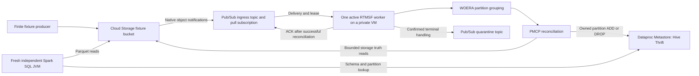

# GCP native functional experiment

The native GCP proof uses Cloud Storage notifications, Pub/Sub, one private VM
running the existing RTMSF core, and Dataproc Metastore with a private Hive
Thrift endpoint. A separate Spark JVM verifies the named Hive table and its
Parquet rows. The [saved results](../evidence/gcp/README.md) cover twelve live
gates and a completed 24-hour serialized lifecycle run.

## Architecture

The producer and supervisor are experiment tools. The supervisor starts one
finite worker at a time and records actual child exits before replacements.
The worker uses the ordinary VM identity through application default
credentials. Spark runs separately for query witnesses; the experiment does
not use a managed Spark cluster or a persistent Spark worker.

Cloud Storage FINALIZE, DELETE and ARCHIVE events carry generation and event
identity into the bounded Pub/Sub adapter. The existing router selects an
owned table and ordered partition path. WOERA groups observations; PMCP uses
the GCS and Hive Metastore adapters to reconcile storage/catalog membership.
The source adapter renews delivery leases and acknowledges completed work.
Quarantine publication must be confirmed before terminal acknowledgment.

The serialized producer waits for a matching FINALIZE/ADD/ACK before deleting
its generation. The next creation waits for DELETE/DROP/ACK and fresh storage
and catalog absence. Mutations are separated by at least five seconds after
the preceding mutation completes. Native delivery and retry waits can extend
that interval. This constrains the lab workload; concurrent sole-file deletion
can encounter the documented native directory-marker race.

## Schema and ownership

The experiment setup created the schema before starting RTMSF. RTMSF maintains
partition membership in existing external tables; it does not infer schemas.

| Database | Table | Columns | Partition key | Final registered partitions |
|---|---|---|---|---:|
| `gcp_probe_r20261018_e504` | `catalog_probe` | `value STRING` | `dt STRING` | 0 |
| `gcp_probe_r20261019_p1` | `catalog_probe` | `value STRING` | `dt STRING` | 0 |
| `gcp_native_r20261019n1` | `native_events` | `value STRING` | `dt STRING` | 11 |

All three tables use Parquet storage descriptors and `EXTERNAL_TABLE`.
`gcp_probe_run_id` binds each table to its experiment owner, and
`external.table.purge=false` protects external data. The native table points to
`gs://rtmsf-gcp-lab-20261018-e504-fixtures/gcp-native/native-r20261019n1/data`.
Its immutable `_OWNER.json` object is also checked before mutation.

[schema.sql](../evidence/gcp/schema.sql) records the captured database/table DDL
and exact retained partition locations. The fresh catalog JSON in the evidence
bundle preserves the actual descriptors, parameters and partition values.
The DDL is a reference for reconstruction and does not recreate the data files.

## Implementation and validation

- [GCP adapters](../src/rtmsf/adapters/gcp.py): bounded GCS truth reads, owned
  Hive catalog operations and native Pub/Sub delivery handling.
- [Finite worker](../src/experiments/gcp/run.py): reviewed lab resource guards,
  ordinary worker composition, bounded runtime and safe evidence.
- [Crash harness](../src/experiments/gcp/crash_worker.py): experiment-only
  boundary faults for actual native redelivery and reconciliation.
- [Soak supervisor](../src/experiments/gcp/soak.py): serialized mutations,
  finite producer, bounded settling, preserved child failures and read retries.

The deployed source is commit `7688fd5523b8e1ca1677ae9cc0d9373df516e77c`.
Frozen validation passed 1,369 local tests, source/wheel builds, sequential spec
and quality reviews, installed hashes, dependency checks and the changed-seam
read-only witness. The evidence distinguishes those local checks from real
cloud event, catalog, storage, process-exit and fresh Spark observations.

The final run completed with restarts. Retryable RPC causes remain unproven.
Unicode object filenames passed; the Unicode partition-value Thrift lookup
timed out and is excluded. Sustainable throughput, arbitrary concurrent
writers, uninterrupted runtime, exactly-once delivery and actual billed cost
were not established. AWS performance graphs remain AWS measurements.

## Preservation and shutdown

Selected proof records and exact fresh query outputs are versioned under
`evidence/gcp/`. Source and exported fingerprints are recorded separately when
local paths are normalized. Original full run and wrapper archives remain
retained outside Git. No credentials or native Pub/Sub acknowledgment IDs are
part of the shared bundle.

Dataproc Metastore provides deletion rather than a VM-style stop/pause command.
Preserve and verify its metadata export before deleting the lab service.
Schema DDL alone is not a complete metastore backup. Deleting the service and
stopping the VM are separate operations; fixture objects, retained versions,
final pulse and evidence archives must remain preserved.
