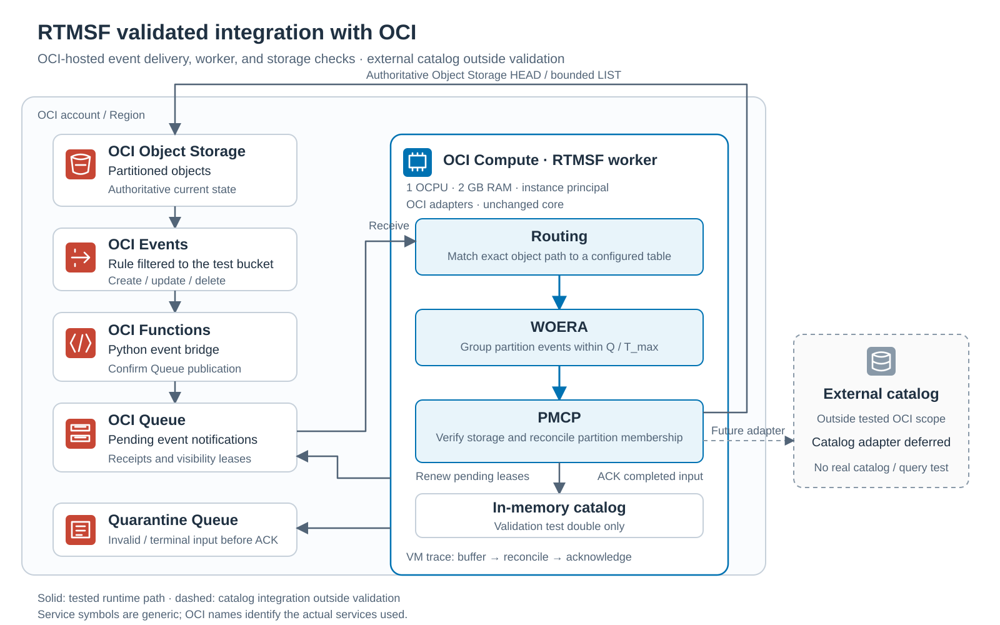

# OCI event/storage integration

The OCI implementation supplies Object Storage and Queue adapters and a Function bridge to the existing provider-neutral core. The core algorithm and AWS adapters are unchanged. The catalog adapter is deferred.



The diagram shows the tested OCI services and the worker deployed on OCI Compute. The cloud test resources were removed after validation; the diagram documents the tested deployment. Its service symbols are generic rather than official Oracle icons. External catalog integration is outside this validation; PMCP used an in-memory catalog test double for the live checks.

Selected original reports, failures and deployed-source fingerprints are now
shared in [evidence/oci/](../evidence/oci/README.md). References below to
`runs/oci-validation/` describe the original private archive; that directory is
not part of this clone. The current [Function handler](../src/rtmsf/oci_function.py)
was relocated into the package after validation. The manual ZIP layout below
has not been redeployed from this source layout.

A small live proof on October 12, 2026 in `us-sanjose-1` passed nine cases through Object Storage → Events → Function → Queue → unchanged routing/WOERA/PMCP/worker. The worker used an in-memory catalog and ran locally. Queue receipt renewal and redelivery also passed across separate processes. An additional live burst run grouped 27 notifications into six reconciliations, with all 27 acknowledged afterward. The recorded outcomes are summarized below; original logs are retained locally under `runs/oci-validation/`.

## OCI Compute validation — October 14, 2026

The unchanged RTMSF worker ran on one temporary `VM.Standard.A1.Flex` Ubuntu 24.04 ARM instance in `us-sanjose-1`: 1 OCPU, 2 GB RAM, and a 50 GB boot volume with 10 VPUs/GB. Its instance-principal identity had access only to objects in the dedicated test bucket and the primary/quarantine queues. The local controller controlled the Events rule; user credentials were not copied to the VM. The producer and consumer ran on the VM against the real OCI event pipeline. Guest instance metadata, source archive digest, SDK version, and frozen dependencies were recorded.

All nine lifecycle checks and four burst cases passed. The burst run recorded 27 notifications, 6 reconciliations, and 27 acknowledgements after reconciliation. The runner checks final test-catalog membership, complete input processing, acknowledgment order, and actual grouping. Notifications arriving after a settling window can correctly cause another reconciliation for the same partition; the report retains that count rather than requiring one reconciliation per producer burst.

A real worker buffered a new object notification, renewed its Queue lease, and was killed with SIGKILL before PMCP or acknowledgment. After confirming that process had stopped, one replacement worker received the same event ID, verified the object, added its partition to a fresh in-memory catalog, and acknowledged it. A subsequent real delete event caused DROP and an empty-prefix check. This verifies replay across process failure with the test catalog; persistent catalog recovery and query visibility remain outside scope.

The controller disabled the rule, deleted only this run's synthetic objects, terminated the VM and boot volume, and removed its temporary policy/dynamic group. Independent API readback confirmed termination, IAM removal, and empty primary/quarantine queues and both DLQs. The earlier quarantine event was present in the October 12 snapshot; it was already absent before this run (queues have one-day retention).

Local records are in `runs/oci-validation/compute-20261015T055634/`. `compute-report.json` gives the run stages; `results/` contains raw events and worker traces, and `cleanup-readback.json` records teardown. The source bundle and manifest identify the deployed uncommitted `oci` source; earlier failed attempts are retained separately. An initial invalid boot-volume setting was corrected from 0 to the supported 10 VPUs/GB. A controller detachment timeout, a storage 404 at burst startup, and a test assertion that incorrectly required one window per partition are preserved as failures. The storage 404 cause remains unresolved; it was not treated as object absence. The revised local suite passed 342 tests.

Published pay-as-you-go rates give approximately $0.0159/hour for this VM and boot volume before free allowances (using 730 hours/month), excluding API and retained-service charges. The VM had a 90-minute shutdown fallback and was explicitly terminated after the finite run. This estimate and the $5 allowance are not a provider-enforced spending cap; actual billing remains unverified.

## Install and test

From the repository root, using Python 3.12+:

```sh
uv sync --frozen --extra dev --extra oci --extra azure --extra gcp
uv run --frozen --extra dev --extra oci --extra azure --extra gcp pytest -q
```

The OCI extra pins SDK 2.187.2 and FDK 0.1.126; `uv.lock` records resolved dependencies.
The full local suite imports Azure and GCP SDKs too, so install all provider
extras as in CI. Local tests make no cloud calls.

## Components

- [OCI adapters](../src/rtmsf/adapters/oci.py): `decode_event`, `enqueue_event`, `OciQueueEventSource`, and `OciObjectStore`.
- [Function handler](../src/rtmsf/oci_function.py): resource-principal event bridge; succeeds only after Queue publication is confirmed. The Function does not run the synchronization worker.
- [Lifecycle](../src/experiments/oci/run.py), [burst](../src/experiments/oci/bursts.py), and [restart](../src/experiments/oci/restart.py) runners: finite worker checks, with a clearly labelled `MemoryCatalog` test double.
- `tests/test_oci_adapters.py`, `tests/test_oci_functional.py`, `tests/test_oci_bursts.py`: contract, failure, worker, and report tests.

Map logical source IDs to `(namespace, bucket)` for both adapters. The parser accepts documented `objectstorage` and observed `ObjectStorage`, maps create/update to CREATE and delete to DELETE, and preserves exact object keys. Namespace and bucket must match together. Storage authorization errors must not imply absence.

Use each Queue's returned `messagesEndpoint`. Keep source and quarantine separate. Receive retains receipts privately; renew extends visibility; acknowledgement deletes only after the existing worker completes the associated work. Invalid input must be durably copied to quarantine before source deletion. Uncertain handoff/renewal/acknowledgement stops processing for replay. Publication timeout can produce duplicates.

Successful test settings: 1-second settling, 3-second maximum window, 120-second lease, 20 pending deliveries, 20-second source/PMCP budgets, zero-wait polling and 0.25-second pacing. Clients used finite transport timeouts and disabled SDK retries. Long polling hung in the initial attempt and remains unvalidated. Monitor explicit quarantine and both provider DLQs; retention expiry and missed notifications require operational recovery outside this proof.

## Live resources and authentication

The test created a dedicated private Standard bucket, primary Queue, quarantine Queue, Functions application/bridge, filtered Events rule, and two narrow IAM policies in `ocilabs`. Queues use one-day retention, 120-second visibility, and 20 maximum delivery attempts. Versioning is disabled for this current-object test.

The Function uses managed code-only Python `python312.ol9`, 256 MB, 30-second timeout, no provisioned concurrency, in an existing subnet with Queue endpoint access. Existing networking and `oci-bucket` were untouched. Its configuration has `RTMSF_QUEUE_ID` and `RTMSF_QUEUE_ENDPOINT`; these are resource identifiers, not credentials. Grant the Function principal queue-push only to the new primary Queue, the application principal read access only to its archive bucket, and Events invocation only to the new Function. The October 12 local worker used the signed-in user. The October 14 Compute worker used a narrowly scoped instance principal; its temporary IAM resources were removed after validation.

The deployed ZIP had root `function/` with `func.py`, adapters, and neutral RTMSF files, and root `python/` with Linux x86_64 Python 3.12 dependencies. It was uploaded through Object Storage because it exceeded the direct archive limit. No registry was used. To package this branch, use `src/rtmsf/oci_function.py` as `function/func.py`, include the `rtmsf` package under `function/`, and supply compatible Linux dependencies under `python/`; handler remains `func.handler`. This branch's relocated packaging has not been redeployed. Exact previously deployed source is retained in `runs/oci-validation/deployed-bridge/` (local only).

Create temporary session authentication with the OCI CLI when needed. The CLI itself is not a project dependency. By default the runners use a session-token profile and internally read its configured token/key files; on OCI Compute, `--instance-principal` uses the instance identity without reading user config. Never include user tokens or signing keys on the guest; never include `.oci/` in evidence or Git. Resource metadata from the original deployment remains in the local workspace, outside this repository. Configure your own resources for another account.

## Finite live runner

This command changes objects and sends messages. It is **not** part of local pytest. Before running it, authorize the cloud work and provide a dedicated test bucket, queues, working Function/rule, and either a session-token profile or a scoped OCI Compute instance identity. A resource JSON needs `namespace`, `region`, and `resources` with `bucket`, `queue: {id, endpoint}`, and `quarantine: {id, endpoint}`.

```sh
uv run --frozen --extra oci python -m experiments.oci.run \
  --resources /absolute/path/to/resources.json \
  --output-dir runs/oci-functional-unique \
  --prefix table-fresh-run/ \
  --config-file ~/.oci/config --profile RTMSF_OCI
```

The script refuses buckets other than the dedicated `rtmsf-events-20261012` in `us-sanjose-1`. `--prefix` selects one fresh relative table directory ending in `/`; the default is `table-retry/`. Existing objects under that prefix and existing report files cause refusal. Use a fresh prefix and output directory for each repeat. Do not use a real production bucket. Enable the rule only for the finite test and disable it afterward; the runner does not provision or disable resources automatically. Output includes actual event envelopes, so use synthetic object names.

## Resource cleanup

After validation on October 14, 2026, the dedicated test bucket and four synthetic objects, both queues, Events rule, Function, Functions application, and two pipeline IAM policies were deleted. Independent inventories confirmed their removal. All temporary worker VMs, boot volumes, policies, and dynamic groups had already been removed. The existing `oci-bucket`, networking, and stopped `Web-Server-01`/`Web-Server-02` instances were left unchanged.

Code, raw reports, source provenance, and the verified deployed Function ZIP remain locally under Git-ignored `runs/oci-validation/`. Final pipeline deletion is recorded in `teardown-20261015T064354/pipeline-teardown-report.json`; the ZIP and its digest are in `deployed-bridge/`. Another live run requires recreating the dedicated pipeline. Prior usage may appear in billing later; actual billing remains unverified.

Live coalescing is verified by the four burst cases, but real catalog writes, query visibility, persistent-catalog crash recovery, sustained load, total API savings, missed-event repair, and long polling remain unvalidated. The first direct Function invocation timed out; a later invocation and the event path succeeded without networking changes, but its exact cause remains unresolved.

## Primary sources

- [Object Storage event types/envelope](https://docs.oracle.com/en-us/iaas/Content/Events/Reference/eventsproducers.htm)
- [Queue overview/retention](https://docs.oracle.com/en-us/iaas/Content/queue/overview.htm)
- [Queue IAM policies](https://docs.oracle.com/en-us/iaas/Content/queue/policy-reference.htm)
- [Code-only Functions](https://docs.oracle.com/en-us/iaas/Content/Functions/Tasks/functions-codeonly-creating.htm)
- [Python archive requirements](https://docs.oracle.com/en-us/iaas/Content/Functions/Tasks/functions-codeonly-python.htm)

## Live burst runner

The separate finite runner tests concurrent production/consumption with one consumer: six creates in one partition, six across two partitions, three intentionally replayed duplicates, and twelve deletes. It uses a fresh timestamped prefix in the dedicated bucket and the existing bridge/rule/queues. By default it refuses an enabled rule or nonempty primary Queue/DLQ at startup, enables the dedicated rule for testing, and disables it in a finally block with API readback. On Compute, use `--instance-principal --external-rule-control`; a separate controller must own rule enable/disable and cleanup, so the guest requires no Events administration permission. Check the printed shutdown status and report if the process is interrupted or network access fails.

Use the lifecycle runner's resource JSON fields above. Default runner-controlled
mode additionally requires `resources.rule.id`, identifying the dedicated Events
rule named `rtmsf-object-events-20261012`, and permission to read/update that rule.
With `--external-rule-control`, the runner does not read `resources.rule.id`;
the controller must enable the rule before the run and disable it afterward.

```sh
uv run --frozen --extra oci python -m experiments.oci.bursts \
  --resources /absolute/path/to/resources.json \
  --output-dir runs/oci-bursts-unique \
  --config-file ~/.oci/config --profile RTMSF_OCI
```

This makes bounded cloud changes and incurs usage; local pytest never invokes it. It uses a 5-second settling window and 20-second maximum window and checks affected partitions, actual grouping, and acknowledgement completeness/order. One producer burst can span multiple reconciliation windows if event delivery is spread out. The successful delete phase removes only its own new burst objects. It uses the same in-memory catalog boundary as the original runner. Recorded results are summarized below; local JSON logs remain under `runs/oci-validation/`.

The first notification took approximately 61 seconds to reach the worker during the recorded burst run. This observed delivery delay is separate from the processing window; its cause and typical frequency remain unknown. The proof establishes tested grouping behavior, not a low-latency or performance guarantee.

## Finite worker restart check

On the same scoped OCI Compute VM, start `experiments.oci.restart` with `--instance-principal`, `--resources`, a fresh `--output-dir`, a fresh `--prefix`, and `--stage buffer`. The controller must enable the rule and create the object `<prefix>dt=a/f1` in the dedicated bucket. Wait for `buffer-report.json` to confirm `buffered_without_ack` and `renewal_succeeded`; validate its PID belongs to that buffer process before sending SIGKILL. Confirm the old process has stopped, then run the same command with `--stage replay`. The replacement waits for lease expiry, checks the same event ID, performs ADD and acknowledgment, and deletes its own object to check DROP. It refuses overwritten reports or an active previous PID. The controller must disable the rule and release the temporary VM, boot volume, and IAM resources in a finally step. The exact deployment/controller snapshot is retained with the Compute run, outside Git.

## Recorded validation results

The October 12, 2026 OCI checks are functional validation, separate from the published AWS experiments. Nine lifecycle cases covered create, additional object, overwrite, a second partition, partial deletion, last-object deletion, recreation, stale-delete replay, and exact storage readback. A separate two-process Queue check verified receipt renewal, redelivery after exiting without acknowledgement, and acknowledgement by the second process.

| Live burst | Notifications | Reconciliations | Acknowledgements |
| --- | ---: | ---: | ---: |
| Six creates in one partition | 6 | 1 | 6 |
| Six creates across two partitions | 6 | 2 | 6 |
| Three intentionally replayed duplicates | 3 | 1 | 3 |
| Twelve deletes across two partitions | 12 | 2 | 12 |

All four burst cases passed, with 27 notifications acknowledged after reconciliation. Storage readback confirmed the burst prefix empty after the delete case. The first notification reached the worker at 61.3 seconds after test start; the reason for that delay remains unknown. These are reconciliation counts, not total API request counts or a cost measurement. The complete local suite recorded 332 passing tests after the burst runner was added.

Original records, initial failures, final resource snapshots, deployed bridge source, and the additional Compute records are preserved under Git-ignored `runs/oci-validation/`. That local directory is not distributed by Git. Key files are `live-report.json`, `live-raw-events.json`, `burst-report.json`, `burst-raw-events.json`, `restart-stage1.json`, and `restart-stage2.json`. Its README describes the recorded checks. Future runs should also write to `runs/`; publication bundles belong in `evidence/` only when selected for the paper.

OCI's selected publication bundle is in [evidence/oci/](../evidence/oci/README.md),
separate from the AWS graph inputs, report generators and measurement provenance.
OCI checks do not enter AWS plots. Real catalog writes and query visibility,
sustained load, long polling and billed cost remain unverified.
