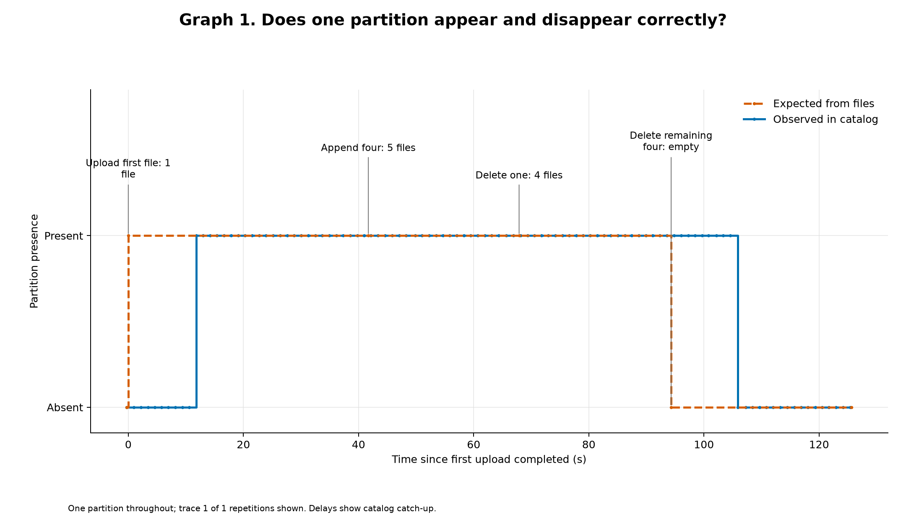
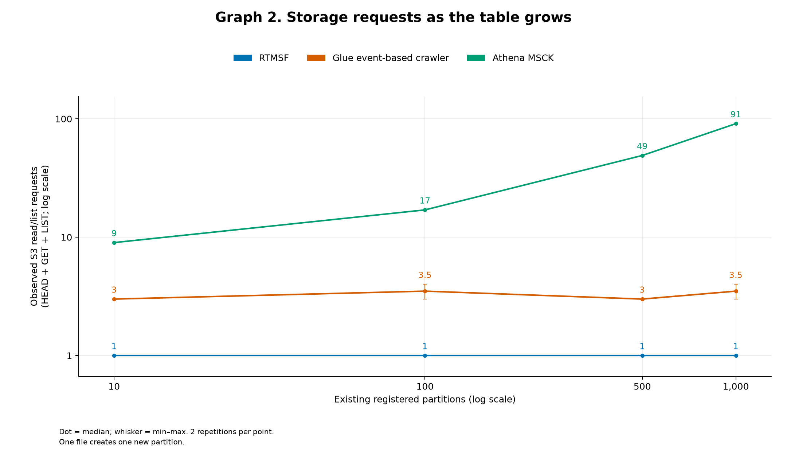
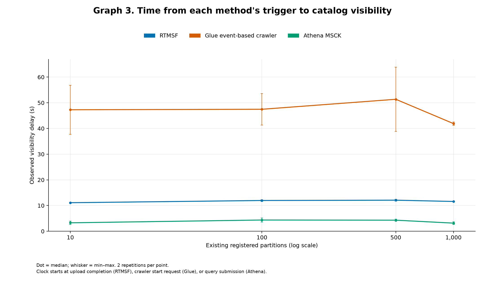
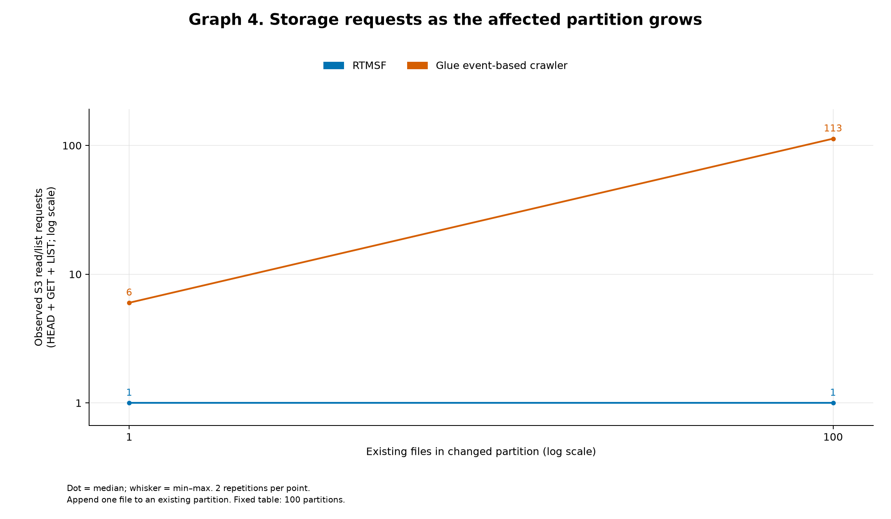
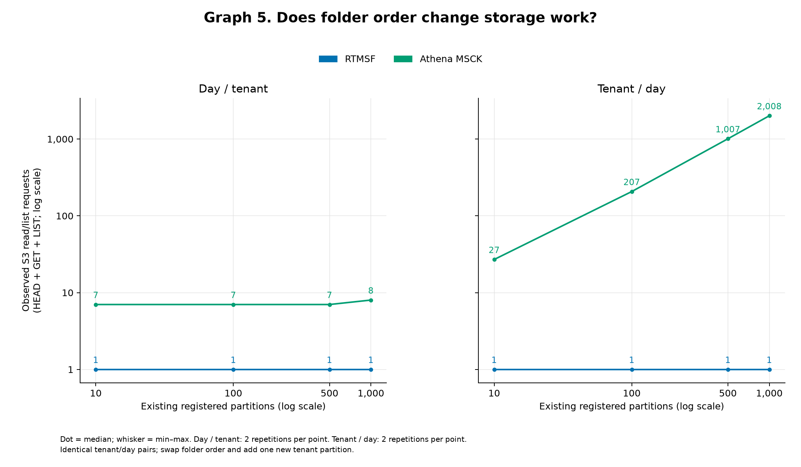

# RTMSF: Event-Driven Partition Membership Maintenance for Existing Cloud Data Lakes

**Ankit Joshi** · Independent Researcher, USA

October 2, 2026

## Abstract

Independent ingestion, backfill, and cleanup jobs can change ordinary object-store
files without updating the partition membership of an existing Hive-style catalog.
Scan-based repair discovers missing partitions, while event-based crawlers can
limit discovery to affected folders. This paper presents the Real-Time Metadata
Synchronization Framework (RTMSF), a provider-neutral system specialized for
known-schema partition membership. WOERA groups notifications by partition using
processing-time settling windows; PMCP checks current storage and performs
idempotent catalog additions or removals. Unacknowledged notifications supply
replay after worker failure. An AWS implementation is evaluated against Athena
MSCK and a Glue event-based crawler using valid Parquet data, independent catalog
observations, and corroborated S3 request measurements. Across the tested
10–1,000-partition range, RTMSF used one HEAD request for an isolated new partition.
For an append to a registered partition containing 100 files, RTMSF used one LIST
request, while the configured crawler used 113 HEAD/GET/LIST requests. A controlled
per-event handler comparison required 20 storage checks for 20 quick uploads to
one partition, versus one for RTMSF; both required 20 when uploads targeted 20
different partitions. Active-load trials retained progress and correct final
state, but a single worker accumulated backlog at 20 changes/s across 1,000
partitions. Increasing its buffer improved catch-up without establishing sustained
capacity at that rate. Athena and the immediate handler exposed new partitions
sooner in their tested comparisons. The evidence supports bounded storage
inspection and workload-dependent coalescing, with an explicit delay and capacity
tradeoff, rather than universal performance or cost superiority.

**Keywords:** partition membership; metadata reconciliation; object storage;
Hive catalog; event coalescing; crash recovery.

## 1. Introduction

Hive-style external tables describe data stored beneath partitioned object-store
prefixes. A query engine can read files in a registered partition, but a newly
created partition may remain invisible until its catalog entry is added. Conversely,
deleting every file in a partition can leave a stale catalog entry. Storage and
catalog changes are separate operations when ingestion and cleanup jobs write
ordinary files without participating in a shared table commit protocol.

This paper addresses that deployment condition. Table identities, schemas, and
partition layouts are already known. Writers need not change their data format
or call the catalog. The task is to maintain membership: register nonempty
partitions and remove registrations for empty ones. It does not include discovering
new tables, inferring schemas, providing table transactions, or indexing records.

Consider a catalog-driven sales-data dispatcher. Independent ingestion jobs write
files into tenant/hour partitions, while retention jobs delete expired data.
The dispatcher enumerates the catalog to discover partitions and schedule work.
A missing registration delays discovery of new input; a stale registration can
schedule a task that finds no files. Membership maintenance therefore serves the
dispatcher's existing discovery interface. This is a motivating workflow, not a
deployed consumer measured here. Membership identifies nonempty storage; batch
readiness and the presence of queryable rows remain separate concerns.

The intended deployment needs enumerated membership in an existing catalog,
potentially shared by multiple consumers. An Athena-only deployment with predictable
partition values may avoid this task through partition projection [12]. Empty
registrations ordinarily return no rows; their removal serves accurate catalog
enumeration and metadata maintenance. We do not measure a query-result error
caused solely by retaining an empty registration, or quantify production demand
for removal. Multi-engine consumption is a deployment motivation, not a measured
result of the present AWS query checks.

Athena MSCK discovers and registers missing Hive-style partitions by inspecting
storage [1]. Glue's event-based crawler consumes notifications to restrict
subsequent crawls to affected folders after initialization [2]. Both are relevant
alternatives. An event-based crawler already provides work locality, so comparing
only against a full scan would miss the stronger question: how much inspection
is needed when the schema is known and only partition membership must be decided?

RTMSF uses an object notification to identify a partition worth checking. The
notification does not establish its current state. One surviving object establishes
nonemptiness; an empty-prefix observation justifies attempting removal within the
system's stated concurrency boundary. This permits bounded storage checks without
reading the files to discover their contents. Coalescing reduces repeated checks
when many notifications concern the same partition.

The contribution is the complete membership-maintenance system and the evidence
for its design choices:

1. An integrated design for existing catalogs and independently managed writers,
   combining partition routing, event coalescing, bounded storage verification,
   catalog mutation, and delivery acknowledgement through provider-neutral interfaces.
2. An explicit processing and recovery contract for the combined WOERA and PMCP
   system, including retained-message replay, bounded retries, and limits imposed
   by non-atomic storage and catalog operations.
3. An AWS evaluation with retained reproduction inputs that separates namespace
   traversal, affected-folder file inspection, and repeated checks of the same
   partition. Two deployed AWS alternatives and a controlled per-event comparison
   establish the measured work/delay tradeoffs; lifecycle, crash, active-load, and
   buffer checks exercise the system's behavior and operating limits.

WOERA and PMCP describe complementary parts of this system. Event grouping,
existence checks, retries, idempotence, and replay are established techniques.
The proposed contribution is their integration for this external-catalog task,
the explicit processing contract, and the measured consequences of specializing
maintenance to membership. Portability is a design property; the evaluated
implementation is AWS only.

## 2. Background and related work

**Discovery and repair.** Athena's `MSCK REPAIR TABLE` discovers missing
partitions and adds them to the catalog; it does not remove stale partitions [1].
Its request count depends on the namespace it traverses. A partition count is
therefore not an implementation-independent prediction of one LIST per partition.
Glue event-based crawling uses S3 notifications delivered through SQS after an
initial crawl. Events identify affected folders, but a subsequent crawl must
still be started by API or scheduling [2]. Our comparison uses an initialized
event crawler with an existing catalog-table target and schema-preserving settings.
It measures that configuration, not every Glue mode.

**Ordinary-file automatic refresh.** Snowflake external tables can refresh file
metadata from S3 notifications through SQS, adding new files, updating changed
files, and removing files no longer present [10]. External-table partition
expressions can derive partition values from paths [11]. This is directly relevant
precedent for metadata refresh without a writer-managed table commit protocol.
It maintains Snowflake external-table file/partition metadata rather than providing
an adapter for an existing shared Hive catalog. Its documentation does not establish
RTMSF's bounded-check behavior; this paper provides no performance comparison with it.

**Avoiding registration.** Athena partition projection derives partition values
from configured rules and ignores registered partition metadata [12]. For suitable
Athena-only workloads, including predictable layouts like our fixtures, this can
remove the need for registration maintenance. It does not maintain an exact
partition set for other consumers of the shared catalog. We therefore distinguish
this deployment alternative from the measured registration baselines.

**Format-managed metadata.** Delta Lake maintains table metadata through its
transaction log and commit protocol [3]. Hudi's metadata-as-data design supplies
metadata and indexes within Hudi-managed tables [4]. These systems offer broader
table-management capabilities and are architectural alternatives when writers
can adopt their protocols. Their published query/index benchmarks do not measure
the same task as reconciling an existing catalog after arbitrary ordinary-file
writes. Their different approach is relevant to deployment choice, rather than
a reason to classify all metadata management as the same problem.

**Catalog infrastructure and recovery mechanisms.** TreeCat addresses catalog
storage, querying, and transactions; its discussion identifies integration of
physical data and metadata consistency as a remaining challenge [5]. RTMSF operates
against an existing catalog's partition APIs. MillWheel provides relevant precedent
for durable processing and failure recovery [6]. RTMSF's external effects remain
idempotent operations with replay, rather than exactly-once execution. These
systems inform the design but are not interchangeable measured baselines.

| Approach | Where metadata maintenance originates | Relationship to this work |
|---|---|---|
| Athena MSCK | On-demand or scheduled discovery of storage paths | Measured ADD repair baseline; no stale-partition removal |
| Glue event-based crawler | Notifications select folders for a started crawl | Closest measured event-based alternative for ordinary files |
| Snowflake external-table refresh | Notifications update external-file metadata and derived partitions | Related automatic-refresh service for Snowflake's catalog |
| Athena partition projection | Query-time derivation of configured partition values | Can avoid registration for suitable Athena queries; does not maintain shared catalog membership |
| Delta Lake / Hudi | Table-format commit and metadata protocols | Architectural alternatives requiring compatible writers |
| TreeCat | Catalog operations and internal metadata organization | Complementary catalog infrastructure |
| RTMSF | Notifications, partition-level coalescing, and bounded current-storage checks | Known-schema membership maintenance with retained-input replay |

An event handler is the code that receives a notification and processes the
resulting work. An immediate handler checks each event separately; a grouped
handler combines events for the same partition before checking. Section 5.7
compares RTMSF with an immediate control using the same worker, PMCP, adapters,
retries, and acknowledgement rules. This isolates the effect of grouping within
the implementation; the control is not an independently optimized competing system.

A straightforward grouped handler with equivalent timing, bounded storage checks,
ownership, retry, and delivery-completion rules could provide the same central
storage-work bound and retained-input recovery behavior. RTMSF specifies and
implements that general design; no fundamental advantage over an equally capable
grouped implementation is established here. This is an analytical comparison to
a design pattern, not another measured or published system. The systems claim
rests on the integrated design and its evaluated tradeoffs. The literature
comparison establishes scope and responsibilities, rather than proving that no
earlier system could implement this contract.

## 3. System model and design

### 3.1 Membership and assumptions

For a configured partition prefix *p*, let *S(p)* indicate that storage contains
at least one object under that prefix and *C(p)* indicate a catalog registration.
The reconciliation target after relevant activity settles is *C(p) = S(p)*.
This is a target state, not a transactional invariant during concurrent writes.

Initial alignment is assumed or must be supplied by a separate repair procedure;
an untouched drifting partition is not visited by this worker. Convergence requires
an adequate eligible notification after the relevant final storage-state change,
followed by successful processing within the retention/retry limits.

The current implementation routes CREATE and DELETE notifications for every
object beneath a fully matched configured partition path, including markers and
nested objects. Partition values and decoded object keys are preserved exactly.
Its emptiness check counts any remaining object. A marker-only prefix therefore
counts as nonempty; membership does not assert that queryable rows exist.

The source used for the five primary figures routed only Parquet-file events.
That version could leave stale membership after a final `_SUCCESS` deletion.
Routing was subsequently aligned with PMCP's all-object existence check, without
changing WOERA or PMCP. The separate validation run exercises marker-only
registration, deletion of Parquet while a marker remains, and removal after the
marker is deleted (Section 5.6). Primary figures use marker-free fixtures;
their older source is retained and is not presented as covering this correction.

The contract assumes that relevant notifications are admitted to the configured
event source and retained long enough for processing, routing is valid, and the
worker and providers are available for retries to make progress. The AWS deployment
uses one active worker. Permanent notification omission, queue purge or expiry,
permanent provider failures, and external schema changes are outside the contract.
Checks of storage and changes to the catalog are not atomic with arbitrary writers.

### 3.2 Architecture and routing

```text
Ordinary file writes/deletes in object storage
                    |
             retained notifications
                    |
        normalize and route to known partition
                    |
          WOERA: coalesce observed activity
                    |
          PMCP: check storage, update catalog
                    |
     complete all work or durably record terminal input
                    |
                acknowledge
```

The core uses four interfaces: event source, object store, partition catalog,
and telemetry sink. At startup, the AWS catalog adapter resolves configured table
locations and partition columns. Routing rejects overlapping roots and maps each
eligible object key to one table and partition. Configuration changes require a
controlled restart. The current routing implementation iterates over configured
tables; it is not a demonstrated constant-time lookup over a large table fleet.

The public data flow is `ObjectEvent → PartitionEvent → PartitionIntent`.
Delivery handles remain separate from these algorithmic values. Source timestamps
remain optional event metadata; the worker's monotonic clock determines deadlines.
The AWS adapters use S3, Standard SQS, and Glue; an ECS/Fargate task runs the worker.

The worker depends on the `EventSource` interface, whose operations receive,
acknowledge, renew, and durably record terminal deliveries. AWS receipt handles
and SDK calls remain inside `SqsEventSource`; `aws_app.py` supplies the wiring.
Acknowledgement accepts a sequence of deliveries, without requiring a native
batch API. An alternative adapter may implement it with individual calls, within
its declared call/lease budgets and failure semantics. This separation supports
porting; it does not establish conformance of an unimplemented cloud adapter.

### 3.3 WOERA: processing-time coalescing

WOERA, the Weakly Ordered Event Reconciliation Algorithm, maintains one active
record per observed partition. A record holds its first observation time, current
deadline, candidate mutation, observation count, and at most three observed CREATE
keys. For an arrival at local time *t*, initial eligibility is:

```text
eligible = min(t + Q, first_observation + T_max)
```

The quiet interval *Q* restarts on an observed arrival. *T_max* prevents continuous
arrivals from indefinitely extending initial buffering. A scheduled retry imposes
a separate lower bound on eligibility; a new arrival cannot bypass that retry.
These are processing-time rules, not event-time watermarks or a bound on end-to-end
visibility. Worker scheduling, delivery, provider calls, and retries add time.

Within a window, any CREATE makes the candidate ADD; otherwise the candidate is
DROP. This ADD-dominance rule aggregates observations without assuming their
source order. PMCP still consults storage, so the candidate is not a command to
blindly create or delete a registration. After completion, later notifications
can open another window for the same partition.

A versioned deadline heap supports scheduling; stale entries are periodically
compacted. The worker limits pending deliveries, events, and partitions to avoid
unbounded intake. Bounded coalescing state does not mean the system can accept an
unlimited arrival rate. The AWS adapter additionally limits retained raw message
bytes and stops fetching when capacity is unavailable; excess input remains in
SQS. The default limits are 100 deliveries, 1,000 active partitions, 10,000 decoded
events, and 16 MiB of raw payload. Parsed events, table definitions, and SDK memory
require additional RAM. Sections 5.8–5.9 report bounded activity and overload
observations; retry storms and many-table throughput remain unmeasured.

### 3.4 PMCP: membership decisions

PMCP, the Partition Mutation Commit Protocol, uses current storage observations
and catalog state. The following table describes its decision paths. A prefix
check requests at most one listed object; file contents are not inspected.

| Candidate and catalog state | Storage observation | Action |
|---|---|---|
| ADD, absent | An observed CREATE object exists by HEAD, or fallback prefix is nonempty | Create registration |
| ADD, absent | No observed object or prefix content found | Retry; eventual exhaustion is terminal |
| ADD, registered | Prefix nonempty | Keep registration |
| ADD, registered | Prefix empty | Remove stale registration, then retry |
| DROP, registered | Prefix nonempty / empty | Keep / remove registration |
| DROP, absent | Prefix nonempty / empty | Create registration / no change |

The absent-ADD path checks at most three observed keys before one bounded LIST
fallback. The measured normal new-partition path succeeds with its first HEAD.
AlreadyExists and NotFound responses are treated idempotently. Transient provider
errors become retries; fatal errors receive terminal handling. The word “commit”
in the protocol name denotes completion of this processing step, not an atomic
transaction spanning object storage and the catalog.

The storage-work argument is local: existence can be established by one object,
whereas absence requires checking the prefix. For *A* PMCP attempts, bounded HEAD
and prefix checks give O(*A*) storage-check invocations, independent of unrelated
partition count. *A* includes retries and later windows for the same partition;
it is not always the number of distinct changed partitions. Every event must still
be consumed, and provider-side LIST cost is not inferred from this API-call bound.
Catalog, queue, compute, and telemetry work are additional costs.

### 3.5 Delivery completion and crash recovery

The worker retains each delivery until every partition intent derived from it
has completed or the terminal input has been durably copied to the dead-letter
queue. It then acknowledges the delivery. Leases are renewed while work is pending.
An unsafe lease or detected operation-budget overrun terminates the worker for
replay; SDK timeouts are not a hard guarantee against every OS or network stall.

A crash discards in-memory coalescing state. Unacknowledged input reappears from
SQS and opens fresh windows. If a catalog call succeeded before the crash, replay
may attempt it again; current-state checks and idempotent catalog responses handle
that uncertainty. No separate checkpoint database is required by this deployment.
This is not exactly-once mutation execution or a distributed fencing protocol.

After storage has stopped changing, a successful appropriate observation and
catalog update can establish the desired membership. During concurrent activity,
a writer may change storage between a check and its catalog operation. Subsequent
admitted notifications can trigger reconciliation, subject to retention, retries,
and terminal failure handling. A stale CREATE whose file has disappeared can
exhaust retries and enter the dead-letter queue even when the catalog is correctly
empty. The system must not be described as error-free for every event ordering.

## 4. Experimental methodology

### 4.1 Implementation and fixtures

All five figures use execution `run_20260930_004034_214f`, initiated September 30,
2026 UTC in AWS `us-west-2`. The worker uses one ARM64 Fargate task with 0.25 vCPU
and 512 MiB, *Q* = 10 s, *T_max* = 31 s, a 180 s SQS visibility lease, and at most
five retries after an initial PMCP attempt. Source and image identities, trial
settings, service responses, query results, and artifact hashes are retained.
All recorded MSCK queries selected `AUTO` and used effective Athena engine
version 3.

The main layout is:

```text
orders/dt=2026-01-01/site=site-000/hour=00/part-000001.parquet
```

All partition columns are strings. Hours 00–23 are filled before moving to the
next site, and dates advance after 100 sites. Each file is valid Snappy Parquet
with one row: `record_id` and `amount` are BIGINT, with `amount = 10 × record_id`.
Corresponding method fixtures use identical file bytes. Every comparison
condition, method, and repetition receives a fresh table and bucket. Existing
partitions are registered before measurement; initialization, setup notifications,
and baseline query checks finish before the measured change.

The evaluated matrix is:

| Output | Conditions actually run | Repetitions | Comparison trials |
|---|---|---|---:|
| Figures 2 and 3, shared trials | 10, 100, 500, 1,000 starting partitions; three methods | 2 per condition/method | 24 |
| Figure 4 | 1 or 100 existing files in one partition; 100 starting partitions; two methods | 2 per condition/method | 8 |
| Figure 5 | 10, 100, 500, 1,000 starting partitions; two layouts; two methods | 2 per condition/layout/method | 32 |
| Figure 1 | First file, append, partial deletion, final deletion | 1 lifecycle | — |
| Recovery and supporting checks | Four crash cases and seven check types | 1 per case/type | — |

There are 64 distinct comparison trials. Figures 2 and 3 reuse the same 24 trials;
they are not independent experiment sets. Method order rotates between repetitions,
and layout order reverses. Two repetitions describe observed variation but do not
support tail-latency estimates, confidence intervals, or stable service rankings.

### 4.2 Baselines and measurement endpoints

RTMSF runs continuously. Athena receives an actual `MSCK REPAIR TABLE` command
promptly after the new file upload. The Glue crawler targets an existing catalog
table in `CRAWL_EVENT_MODE`, preserving table schema and inheriting it for partitions.
It completes its initial crawl and starts a subsequent crawl once the new
notification is available. Startup and initialization work are excluded from
steady-state request measurements for all methods.

The crawler has `UpdateBehavior=LOG`, `DeleteBehavior=LOG`, and partition
`AddOrUpdateBehavior=InheritFromTable`. Its deletion policy logs changes rather
than removing stale registrations. The cross-method trials therefore compare ADD
and append work; full ADD/DROP lifecycle correctness is tested only for RTMSF.

Figure 3 ends at the first successful independent Glue `GetPartition` observation,
polled approximately once per second. Its method-specific starts are:

| Method | Timer start |
|---|---|
| RTMSF | Successful upload response |
| Athena MSCK | Immediately before `StartQueryExecution` |
| Glue event crawler | Immediately before `StartCrawler`, after notification availability |

Submission latency, queueing, and execution after these starts remain included.
RTMSF's timing additionally includes event delivery and its intentional settling
window. The graph does not measure a common upload-to-visibility interval or a
production scheduling delay. Polling measures first observed visibility, not the
exact catalog-write instant. An independent SELECT verifies query rows afterward;
SELECT completion is not the timing endpoint.

### 4.3 S3 request accounting and correctness checks

The work metric is observed S3 HEAD + GET + LIST requests during maintenance.
Counts continue until processing completes, even if a partition becomes visible
earlier. Separate trial buckets isolate maintenance from other methods. CloudWatch
request metrics are enabled at least 15 minutes before measurement, and known
requests calibrate collection. Two complete quiet minutes follow setup reads;
buckets remain idle during a final 10-minute delivery wait. Fixture creation,
verification queries, calibration, observer activity, and cleanup are excluded
from the maintenance work total.

CloudWatch Sum counters in 60-second periods are corroborated with deduplicated
CloudTrail data events matched to bucket, time window, and requester. HEAD includes
`HeadObject`/`HeadBucket`; GET includes `GetObject`; LIST includes
`ListObjects`/`ListObjectsV2`. Missing measurements remain unknown, not zero.
Both AWS telemetry mechanisms have delivery limitations [7, 8]; agreement and
calibration strengthen the observations without making them billing-grade counts.

Of the 192 CloudWatch components, 112 have component datapoints and 80 zeros are
inferred from absent component series only when collection succeeded, positive
activity was recorded, and known operation counts account for `AllRequests`.
Those inferred observed zeros also agree with retained CloudTrail events; the
inference does not establish complete recording of all service-side activity.

All 192 request values (three components across 64 trials) are available and agree
between the graph CSV and the two recorded counting sources. The 448 calibration
requests matched. Exact catalog membership, partition values, locations, column definitions,
and query rows are verified outside request windows. Verification failures and
unattempted conditions are retained as such; they are not replaced silently.

The main run's verifier checked all partition values, locations, and column
definitions in memory, retaining summaries, targeted observations, and native
query rows. Its full historical catalog snapshots are absent. Complete membership
checks for that run therefore rely on frozen verification code and recorded
assertions; SELECT rows alone cannot exclude extra empty registrations.
The later graph, activity, and buffer runs save expected and observed full
partition sets, locations, and column schemas before assertions. Those saved
comparisons and reconstructed query results match in the successful follow-ups.
This repairs future auditability without supplying missing historical snapshots.

For request figures, HEAD/GET/LIST are summed within each repetition before taking
the median. Figures 2–5 show medians with observed min–max whiskers. Request figures
use logarithmic axes; Figure 3 has linear seconds on Y. Figure 1 plots repetition
1, selected before execution, without averaging binary states. The source CSV
retains individual measurements and the report inputs retain outcomes.

### 4.4 Follow-up evidence and workload protocol

Three separately retained runs extend the primary evaluation. Each has its own
source snapshot, settings, request windows, and outcomes; measurements are not
merged across implementations or treated as additional identical repetitions.

| Evidence set | Execution ID | Scope |
|---|---|---|
| Graph validation | `run_20260930_113402_14ae` | 20 comparison trials at N=100/1,000; affected-file counts 1/100/1,000; lifecycle, four crash cases, and eight supporting checks, once each |
| Activity follow-up | `run_20260930_151218_2a18` | Four burst schedules × two handlers, four continuous membership-changing cases, and four load cases; one repetition each |
| Buffer comparison | `run_20260930_194451_fcee` | Two active-partition pools × two buffer sizes × two repetitions; eight conditions |

The graph phase passed, but its first activity child stopped on a producer
connection failure: ten conditions passed, one failed, and five were unattempted.
The parent remains `incomplete_or_failed`. The named activity follow-up uses fresh
fixtures and retains that failed attempt separately. An earlier fixture-seeding
failure also remains recorded. No failed outcome is relabelled as successful.

Burst and continuous fixtures start with 100 registered one-file partitions.
The immediate control gives each received event its own eligible intent, including
events received in one SQS batch; verification, retries, and delivery completion
remain the same. Both methods use the same image and resource size. The measured
burst comparison has one repetition and runs RTMSF first, then the immediate
control; reversed order is supported by the runner but not measured here.

Continuous membership-changing workloads issue 1 or 3 operations/s for 120 seconds.
Three of every four operations upload across 10 or 20 new target partitions;
the fourth deletes a distinct seed partition's only file. A separate load family
starts with 1,000 registered partitions and keeps their seed files. It appends
three unique files, then deletes the oldest appended file, repeatedly. The selected
points are (1/s,1,000 targets), (5/s,1,000), (20/s,10), and (20/s,1,000).
At 1/s and 5/s only 90 and 450 distinct upload targets are reached; the configured
pool size is not the number of partitions actually exercised at those rates.

The buffer comparison repeats the two 20/s conditions at caps of 100 and 1,000
pending messages, reversing cap order in repetition two. Each condition gets a
fresh 0.25-vCPU/512-MiB process with eight table definitions loaded and traffic
to one table. Both caps use Q=10 s, T_max=31 s, a 16-MiB payload budget, and a
1,000 s lease that covers the larger cap's conservative renewal budget. The longer
lease can delay crash replay. Other reported runs use the 180 s lease; their
timings are not pooled with this comparison.

Actual producer completions, scheduling delays, PMCP progress, observed ACKs,
approximate SQS counts, and retries are retained. Backlog matches completed file
operations to decoded notifications and ACKs, including not-yet-received events;
its age assumes synchronized host/worker clocks. Drain starts after the last
producer completion and includes telemetry waits and eight seconds of observed
queue emptiness. First-partition visibility is independently polled in workloads
that create new partitions; it is not a tail-latency measure across all changes.

The activity follow-up passed 16 conditions/6,640 operations, with all 48 request
components and 112 calibration calls agreeing. The buffer comparison passed
8 conditions/19,200 operations, with 24 components and 56 calibration calls
agreeing. CloudWatch inferred 23 and 16 zero components, respectively, through
the same accounting rule as Section 4.3. Graph validation supplied 60 matching
components and 140 calibration calls. Later catalog snapshots and exact query
rows are retained and audited separately from these request totals.

## 5. Results

### 5.1 Membership lifecycle and recovery

The lifecycle starts with an empty catalog and changes one partition: upload its
first file, append four, delete one, and delete the remaining four. The resulting
file counts are 1, 5, 4, and 0, with desired membership present, present, present,
and absent. Each stage waits for processing and verifies the catalog and query
rows. Figure 1 shows the interval between a storage change and its observed
catalog response. Appending or partly deleting files leaves membership unchanged.
The long intervals between stages include test verification; they are not a
continuous production workload or per-stage latency benchmark.



*Figure 1. One measured lifecycle, with independent catalog polling. The desired
state changes after completed storage operations; observed membership follows
after processing. Negative time is the pre-upload observation.*

For recovery, a separate experiment launcher wraps the real worker. It targets a
partition, operation, and boundary, writes a durable marker outside table data,
and calls `os._exit(86)`. The marker suppresses another injected crash after
replacement. SQS redelivers unacknowledged input, while the external observer
survives. The injection is not part of normal worker startup. Each case completes
an empty → registered → empty lifecycle, with one crash at the named boundary.

**Table 1. Crash recovery.** One attempt per case. State is checked after recovery,
before advancing the lifecycle or cleaning up. Verification includes the injected
exit, replacement without overlapping workers, same-message replay and
acknowledgement, catalog state, and query results.

| Crash boundary | Expected after recovery | Observed | Verified crash | Verified replay + ACK | Passed |
|---|---|---|---|---|---|
| ADD before PMCP processing | Registered | Registered | 1/1 | 1/1 | 1/1 |
| ADD after registration, before ACK | Registered | Registered | 1/1 | 1/1 | 1/1 |
| DROP before PMCP processing | Absent | Absent | 1/1 | 1/1 | 1/1 |
| DROP after removal, before ACK | Absent | Absent | 1/1 | 1/1 | 1/1 |

All four cases passed with no unknown states. This tests recovery at these
boundaries; it is not exhaustive fault injection or validation of concurrent workers.
The later graph-validation run also passed the lifecycle and each of these four
crash cases once, under its separately retained source and settings.

### 5.2 Storage work as the table grows

For each starting size, one file is added in a previously absent partition.
All methods reach the exact expected N+1 catalog and query result. RTMSF uses
one HEAD and no GET/LIST in every measured trial. The event crawler uses 3–4 total
requests. Athena uses 9, 17, 49, and 91 requests at 10, 100, 500, and 1,000 starting
partitions respectively, identically in both repetitions.



*Figure 2. HEAD + GET + LIST for an isolated new partition in the dt/site/hour
layout. Fresh fixtures, two repetitions per method/size; median and min–max.
The event crawler also localizes work at these sizes.*

This supports the locality of RTMSF's new-partition check. The small crawler
counts also confirm that an event-based crawler should not be described as
rescanning every historical partition. Athena's traversal work grows in this
layout, but the count is substantially below one request per partition.

### 5.3 Response time

Across the eight points per method, RTMSF's observed response times range from
11.008 to 12.464 s, the crawler's from 37.734 to 63.883 s, and Athena's from
2.644 to 5.144 s. Athena is faster than RTMSF at every tested size and repetition
under these starts. RTMSF's configured 10-second settling window is included.



*Figure 3. First independently observed catalog presence after each method's
trigger (Section 4.2). Two repetitions per method/size; median and min–max.
No scheduled waiting interval is added to Athena or the crawler.*

The measured Athena request increase does not yield a monotonic visibility-time
increase in this range. Request count alone does not determine elapsed time:
service startup, batching, concurrency, and variation can affect the result.
The measurements do not isolate those internal mechanisms. Similarly, the lower
crawler median at 1,000 than at 500 partitions, with overlapping observed ranges,
is not evidence that larger tables make crawling faster. These results establish
the observed latency tradeoff; they do not predict a future size at which RTMSF
will overtake Athena or show layout-independent response time.

### 5.4 Files within the affected partition

Figure 4 appends one file to an already registered partition, with either 1 or
100 existing files and 100 total starting partitions. Membership should remain
unchanged, and every trial passes that check and the additional query-row check.
This is membership-maintenance work after an append, not the time to expose a
new partition: ordinary queries can already discover files within its registered
location without another registration.

RTMSF performs one LIST and no HEAD/GET in both conditions and repetitions.
The crawler performs 3 HEAD + 2 GET + 1 LIST = 6 requests at one existing file,
and 11 HEAD + 101 GET + 1 LIST = 113 requests at 100 existing files. The growing
component is principally GET inspection, not one LIST per file.



*Figure 4. Append one file to an already registered partition. X counts files
before the append. Two repetitions, 100 starting partitions; median and min–max.
Counts cover all observed HEAD/GET/LIST maintenance requests.*

These observations expose the value of specializing the operation. RTMSF needs
to establish nonemptiness, whereas the configured crawler performs additional
file inspection. This does not establish that the crawler's reads are wasted
for schema discovery, or that every configuration reads all files. It also does
not claim an advantage over deliberately skipping maintenance for an append
known to preserve membership. The comparison measures ADD/append maintenance
under the recorded configurations. It does not show a comparison between two
implementations of the complete ADD/DROP contract, because the crawler's recorded
deletion policy is LOG.

The later graph validation extended the affected-file count to 1,000 with one
trial per method/count. Its crawler totals were 6, 103, and 1,038 requests at
1, 100, and 1,000 existing files; GET counts were 2, 101, and 1,001. RTMSF used
one LIST at each count. The 100-file crawler total differs from the main run's
113 because HEAD counts vary. This follow-up supports the file-inspection trend
without treating the exact total as universal or pooling it into Figure 4.

### 5.5 Folder-order sensitivity

Figure 5 uses identical tenant/day pairs and file bytes in two layouts:
`day=2026-09-25/tenant=t000000/` and
`tenant=t000000/day=2026-09-25/`. A fresh fixture starts with N registered
partitions; one new tenant is added on the same day. The experiment changes folder
order without selecting only an expensive traversal layout for the main comparison.

At 1,000 starting partitions, Athena makes 8 requests in day/tenant order and
2,008 in tenant/day order, in both repetitions. RTMSF makes one HEAD in either
order. At 10, 100, and 500 partitions, Athena's corresponding counts are 7, 7,
and 7 for day/tenant and 27, 207, and 1,007 for tenant/day.



*Figure 5. One new tenant/day partition in two folder orders, with shared axes.
Two fresh repetitions per layout/method/size; median and min–max. The same
partition count can imply very different discovery work.*

Partition count alone therefore does not characterize discovery cost. S3 listing
can group prefixes and paginate results [9]; where values occur in the hierarchy
changes the traversed namespace. RTMSF's checked object is obtained from the
notification, so neither tested order increases its new-partition storage check.
This result concerns request work, not latency or a universal lower bound for
Hive, Spark, or other repair implementations.

### 5.6 Supporting checks

The main run's seven additional checks each passed once. The graph-validation
follow-up repeated them and added the marker lifecycle; all eight passed once.
These test specific behaviors and are not separate comparison curves.

| Check | Workload and observed outcome |
|---|---|
| Short burst | 20 distinct file uploads to one partition; 20 observed events, one PMCP attempt, one applied catalog change; 20 rows verified |
| Long burst | Nine uploads nominally five seconds apart; progress checked at the buffering cap and nine final rows verified |
| Two tables | 30 uploads across three partitions in each of two configured tables; routing and query rows verified |
| Duplicate and old events | Replayed notifications and old CREATE/DELETE after state changes; final membership verified |
| Rapid changes | Create/delete and delete/recreate while the worker is stopped; final state and terminal outcomes checked after restart |
| Retryable failure | Two injected catalog-call failures followed by successful real calls |
| Retry exhaustion | Initial attempt plus five retries fail; durable dead-letter handling before ACK and subsequent healthy replay verified |
| Marker lifecycle (follow-up only) | Marker-only registration; add then delete a Parquet file while retaining the marker; delete the marker last and verify removal |

These checks support the tested coalescing, routing, and failure behavior. The
short burst is not a component-removal experiment and does not imply that every
20 events always collapse to one attempt. Arrival timing, retries, and separate
windows can increase that number. Rapid-change success can include the documented
stale-CREATE dead-letter outcome; a correct final state is not equivalent to no
terminal records.

### 5.7 Coalescing versus the immediate control

Table 2 reports the activity follow-up's four 20-operation burst schedules.
Both handlers passed their final catalog/query checks. Here each completed PMCP
attempt performs one storage check, so attempts and HEAD+GET+LIST totals coincide.

**Table 2. Controlled per-event comparison.** One repetition per method/schedule.
Visibility is seconds from first successful upload to the first new partition's
observed registration; it does not measure completion of every change.

| Schedule | RTMSF / immediate storage requests | RTMSF / immediate first visibility (s) |
|---|---:|---:|
| 20 uploads back-to-back into one new partition | 1 / 20 | 14.404 / 1.388 |
| 20 uploads into one new partition, two seconds apart | 2 / 20 | 32.773 / 1.120 |
| One upload into each of 20 new partitions | 20 / 20 | 12.656 / 1.087 |
| Alternate 10 uploads into one new partition with 10 last-file deletions | 11 / 20 | 15.039 / 2.437 |

Coalescing saves checks when notifications repeatedly concern a partition within
a window; it provides no storage-check reduction for the distributed burst.
The immediate control is faster to first visibility in all four measured cases.
The two-second schedule also forces progress before the quiet interval can finish,
producing two RTMSF attempts. This measures the work/delay tradeoff of enabling
grouping at fixed Q=10/T_max=31. It neither establishes an optimal configuration
nor an advantage over a handler with equivalent grouping and reconciliation rules.

For the motivating dispatcher, an illustrative one-minute discovery budget would
make the quick-burst tradeoff useful: RTMSF used one storage check and exposed
the first partition in 14.404 s, versus 20 checks and 1.388 s for immediate
processing. Both observed times fit that example budget. The budget is illustrative;
the dispatcher itself and a per-partition deadline under ongoing activity are
not evaluated. This connects the observed savings to a possible operating need
without establishing a workload-wide freshness guarantee or total-cost advantage.

### 5.8 Processing during continuous changes

The four 1/3-operation-per-second membership-changing workloads all progressed
while writes continued, drained, and matched their final catalog/query contents.
At 1/s the 120 operations required 120 attempts for both target pools. At 3/s,
360 operations required 130 attempts for 10 targets and 170 for 20. Respectively,
317 and 321 event observations completed during writes. First-new-partition
visibility ranged from 11.068 to 33.384 s across these cases; Q=10 s is not a
freshness guarantee. Each case ran once and is not a sustained-capacity benchmark.

The load family separates queue behavior from membership transitions by retaining
seed files. Table 3 reports the actual achieved rates, unacknowledged operations
when writes ended, their oldest age, and observed drain with the default cap of
100 pending deliveries. All cases ended with the expected 1,000 registrations
and exact query rows. Correct final state does not mean the worker kept up.

**Table 3. Bounded load observations.** One approximately 120-second execution per
condition. The target pool is 1,000 except in the explicitly marked hot-partition case.

| Offered rate / target pool | Achieved operations/s | Unacknowledged at write end | Oldest age (s) | Observed drain (s) |
|---|---:|---:|---:|---:|
| 1/s / 1,000 | 1.007 | 12 | 10.941 | 27.835 |
| 5/s / 1,000 | 4.999 | 57 | 11.254 | 27.663 |
| 20/s / 10 | 19.982 | 1,400 | 83.653 | 180.060 |
| 20/s / 1,000 | 19.986 | 1,544 | 89.760 | 246.364 |

The two 20/s cases expose backlog beyond the intended settling interval. These
measurements describe the supplied serial worker and its configuration, not an
algorithmic maximum throughput. At lower rates the smaller exercised partition
set limits cross-row capacity comparisons. No producer or worker retries occurred
in the successful activity follow-up; one fixture upload recovered before measurement.

### 5.9 Buffer capacity and catch-up

Increasing the shared pending-message cap improves catch-up in both repeated
workloads (Table 4), with a stronger reduction in storage checks for the hot
10-partition pool. All 19,200 operations matched notifications and ACKs; all eight
final catalog sets and independently reconstructed query results matched.

**Table 4. Buffer comparison at 20 operations/s.** Ranges cover two repetitions;
both caps use the same 1,000 s lease. Every measured storage request was LIST.

| Active partitions | Message cap | LIST requests | Unacknowledged at write end | Observed drain (s) |
|---:|---:|---:|---:|---:|
| 10 | 100 | 244–246 | 1,500–1,513 | 194.1–215.6 |
| 10 | 1,000 | 40 | 192–354 | 27.1–32.0 |
| 1,000 | 100 | 2,318–2,327 | 1,619–1,642 | 268.4–274.5 |
| 1,000 | 1,000 | 2,018–2,081 | 1,345–1,390 | 77.6–88.9 |

Peak process RSS across fresh workers was 60.5–64.2 MiB within a 512-MiB allocation;
sampled pending payload remained below 0.81 MiB. A separate local synthetic check
filled the 16-MiB raw-payload ceiling, observed receive backpressure, and verified
that acknowledgement released capacity. It is a safety check, not AWS performance
evidence or a bound on total process memory for arbitrary table configurations.

Two Glue read timeouts recovered through PMCP retries in the second larger-buffer,
1,000-target trial: 2,020 attempts produced 2,018 LIST calls. Two observation reads
also retried; there were no producer retries or DLQ messages. The larger buffer
did not eliminate backlog in the distributed workload or establish sustained
20/s service. Queue retention absorbs finite bursts; permanently exceeding
processing capacity increases lag even when worker memory is bounded.

The cap counts retained notifications, rather than partition groups. When 100
notifications fill it, the worker stops receiving even if those notifications
concern only ten partitions. Input waiting in SQS cannot join a grouping window
until received. After buffered work completes and its deliveries are acknowledged,
later input can open new windows and cause repeated checks. The larger cap admits
more related input before completion: the hot-partition workload averages 60
notifications per storage check, versus approximately ten with the smaller cap.
Across 1,000 active partitions, less activity can be combined and separate checks
remain necessary. The observed lesson is that intake capacity and partition
locality jointly determine grouping effectiveness at fixed Q and T_max.

Pending work at the end of writing also needs an age measure. With the larger
cap, the oldest unacknowledged operation was 9.886–17.857 s old for ten targets,
compatible with intentional grouping, versus 73.297–77.597 s for 1,000 targets.
The latter exceeds the initial grouping interval and indicates accumulated lag.
In the first larger-buffer, 1,000-target trial, task-scoped telemetry records
2,081 catalog reads, 2,081 LIST calls, and 2,400 acknowledgement requests. Their
SDK durations sum to 74.632, 41.609, and 13.315 s respectively, approximately
130 s of serial remote calls for a workload produced in 120 s. Receiving and
other worker activity add time. This accounting explains a limit in the supplied
serial implementation; increasing buffer space alone does not increase its
execution concurrency. It is not a maximum-capacity estimate or a predicted
speedup for a parallel worker.

## 6. Discussion and limitations

The evidence favors selecting maintenance mechanisms by required semantics and
namespace shape. For an isolated addition with an immediately issued command,
Athena is a fast option in the measured range. For workflows requiring schema
discovery, a crawler supplies capabilities outside RTMSF's purpose. For known-schema
membership with independent writers and deletion activity, RTMSF combines local
checks and retained-work recovery while keeping the core independent of AWS APIs.

Reduced S3 requests are not measured lower total cloud cost. SQS traffic,
catalog calls, worker uptime, logging, crawler service charges, and operational
maintenance also matter. No throughput or cost crossover is established. Nor
does a multiple-table deployment force an event-aware MSCK scheduler to repair
every table; a scheduler can target affected tables. The two-table check demonstrates
routing correctness, not large-fleet efficiency.

The main figures have four small partition counts and two comparison repetitions.
Separate graph validation extends the affected-file count to 1,000 and repeats
lifecycle/fault checks once. The immediate-handler comparison has one repetition;
the focused buffer comparison has two. All activity streams last about two
minutes. These observations do not establish stable latency distributions,
maximum sustainable throughput, 100K/500K scaling, long-run reliability, or
production adoption. A Q sweep is not performed: the fixed 10-second setting
demonstrates a tradeoff at that configuration, not an optimum. AWS services and
engines can change; broader runs may revise conclusions as well as numbers.

There is identifiable implementation overhead beyond the core algorithms.
In both 1,000-target, 1,000-buffer trials, worker telemetry records 2,400 SQS
`DeleteMessageBatch` calls for 2,400 notifications: the worker currently passes
one completed delivery at a time. SQS accepts up to ten per request and reports
per-entry failures [13]. Grouping completed acknowledgements could reduce queue
calls; another cloud's adapter could instead issue individual acknowledgements.
The supplied worker also processes partition checks serially. ACK batching and
bounded concurrency across different partitions are deferred engineering
improvements, not evaluated speedups or new WOERA/PMCP contributions. The paper
reports the implementation as measured and does not assume those changes would
eliminate backlog. Buffer tuning alone does not supply unlimited service capacity.

Notifications can be delayed or permanently omitted. Replay only repairs work
that remains admitted and retained; an independent repair procedure may be an
operational backstop. A single worker does not fence arbitrary writers, and an
emptiness observation cannot make catalog removal atomic with new writes.
Multi-worker fencing, table/schema changes, and long-running overload are
unvalidated. Stable routing by table/partition is necessary for exclusive ownership;
sharing this Standard-SQS queue across workers alone does not establish it.
Marker-only prefixes deliberately count as nonempty (Section 3.1). These are
boundaries of the system, not guarantees supplied by the crash tests.

Finally, only the AWS adapters are evaluated. Implementing another provider
requires checking notification, retention, storage, and catalog semantics as well
as translating APIs. Provider-neutral interfaces alone do not demonstrate
cross-cloud conformance. This evaluation does not claim that established recovery
or buffering mechanisms are individually novel, or that the prior-work search
is exhaustive.

## 7. Conclusion

RTMSF integrates event routing, partition-level grouping, bounded storage checks,
and retained-message replay into a provider-neutral membership-maintenance system
for existing Hive-style tables. Writers continue using ordinary object-store
operations. In the measured AWS workloads, bounded storage checks avoid broader
namespace discovery and per-file inspection for this task. The immediate-handler comparison shows
that coalescing saves checks when partition activity repeats within a window,
while exchanging earlier visibility for less work. The distributed burst has
no such reduction. Lifecycle, crash, marker, and active-load checks exercise the
stated processing and recovery contract. Buffer validation demonstrates safe
catch-up in the tested finite workloads, with observed overload rather than a
claim of unlimited throughput. Athena's and the immediate handler's lower
response times reinforce the distinction between storage work and latency.
The evidence supports workload-dependent request reduction under explicit
notification, retention, ownership, and concurrency assumptions.

## References

1. Amazon Web Services. *MSCK REPAIR TABLE — Amazon Athena*.
   https://docs.aws.amazon.com/athena/latest/ug/msck-repair-table.html
2. Amazon Web Services. *Accelerating crawls using Amazon S3 event notifications*.
   https://docs.aws.amazon.com/glue/latest/dg/crawler-s3-event-notifications.html
3. Michael Armbrust et al. *Delta Lake: High-Performance ACID Table Storage over
   Cloud Object Stores*. PVLDB 13(12), 2020.
   https://www.vldb.org/pvldb/vol13/p3411-armbrust.pdf
4. Sagar Sumit, Prashant Wason, and Sivabalan Narayanan. *Metadata-as-Data in
   Apache Hudi: A Multi-Modal Index Substrate for Lakehouse Tables*. Proceedings
   of the 1st International Workshop on Data FORMATS for Modern Architectures
   and Workloads, pp. 1–5, 2026.
   https://doi.org/10.1145/3802514.3809177
5. Keonwoo Oh, Pooja Nilangekar, and Amol Deshpande. *TreeCat: Standalone Catalog
   Engine for Large Data Systems*. PVLDB 18(11), pp. 4323–4336, 2025.
   https://www.vldb.org/pvldb/vol18/p4323-oh.pdf
6. Tyler Akidau et al. *MillWheel: Fault-Tolerant Stream Processing at Internet
   Scale*. PVLDB 6(11), 2013.
   https://www.vldb.org/pvldb/vol6/p1033-akidau.pdf
7. Amazon Web Services. *Monitoring metrics with Amazon CloudWatch — Amazon S3*.
   https://docs.aws.amazon.com/AmazonS3/latest/userguide/cloudwatch-monitoring.html
8. Amazon Web Services. *How AWS CloudTrail works*.
   https://docs.aws.amazon.com/awscloudtrail/latest/userguide/how-cloudtrail-works.html
9. Amazon Web Services. *ListObjectsV2 — Amazon S3 API Reference*.
   https://docs.aws.amazon.com/AmazonS3/latest/API/API_ListObjectsV2.html
10. Snowflake. *Refresh external tables automatically for Amazon S3*.
    https://docs.snowflake.com/en/user-guide/tables-external-s3
11. Snowflake. *Introduction to external tables*.
    https://docs.snowflake.com/en/user-guide/tables-external-intro
12. Amazon Web Services. *Partition projection with Amazon Athena*.
    https://docs.aws.amazon.com/athena/latest/ug/partition-projection.html
13. Amazon Web Services. *DeleteMessageBatch — Amazon SQS API Reference*.
    https://docs.aws.amazon.com/AWSSimpleQueueService/latest/APIReference/API_DeleteMessageBatch.html

## Artifact and reproduction

The repository contains the manuscript, five figures, plotting CSVs, recorded
report inputs and a source-provenance index. The companion full evidence archive
adds per-execution source archives, immutable image/source identities, scoped
request and calibration records, operation/ACK telemetry, query checks and later
catalog snapshots. Failures and historical missing measurements remain visible.
The archive is prepared for release; this manuscript does not assert an assigned
arXiv identifier or a public data DOI.

- [Paper evidence and regeneration commands](../evidence/paper/README.md).
- [Primary graph data](../evidence/paper/figures/graph_data.csv) and
  [report inputs](../evidence/paper/figures/report_inputs.json).
- [Source identities](../evidence/paper/provenance.json), including the primary
  source-manifest digest `b8623cf17cb6c9b2647717dc467cb05c232391cfa96d4ae5346ff724f8116efc`.
  This identifies the sorted source-file hash manifest, not compressed archive bytes.
- [Activity inputs](../evidence/paper/activity/report_inputs.json),
  [buffer inputs](../evidence/paper/buffer/report_inputs.json), and
  [buffer call accounting](../evidence/paper/buffer/call-accounting.json).
- [Experiment specification](../docs/experiments.md),
  [system behavior](../docs/system-behavior.md), and [AWS runbook](../docs/aws.md).

From a clean checkout, install the locked dependencies once and regenerate offline:

```sh
uv sync --frozen --extra dev
uv run --frozen --extra dev pytest -q
uv run --frozen --extra experiment python -m experiments.figures \
  --csv evidence/paper/figures/graph_data.csv \
  --results evidence/paper/figures/report_inputs.json \
  --output-dir runs/regenerated-figures
uv run --frozen --extra experiment python -m experiments.activity_reports \
  --results evidence/paper/activity/report_inputs.json \
  --output-dir runs/regenerated-activity
```

Use the buffer or failed-activity input to regenerate those reports separately.
No AWS account is needed for reporting or local tests. The compact repository
inputs omit verbose audit envelopes; the full archive retains the supporting
records. Account identifiers use a consistent placeholder; credential identities,
receipt handles and source IPs are omitted. Source archives retain their original
bytes. `SHA256SUMS` verifies the exported artifact; original artifact lists refer
to original private bytes and are labelled accordingly.

The runbook gives exact size/repetition options for each measured matrix and
AWS setup, image validation and cleanup. Every execution uses fresh fixtures,
retains its own source version, CSV, outcomes and failures, and generates reports
without manual assembly. Exact historical formatting uses that execution's
archived source. New cloud runs seek comparable conclusions, not identical timing.
Neither the diagnostic Athena-only probes nor older 10K runs supply the five
figures above. Larger-scale evidence and additional cloud implementations are
separate extensions; their outcomes cannot be assumed in advance.
